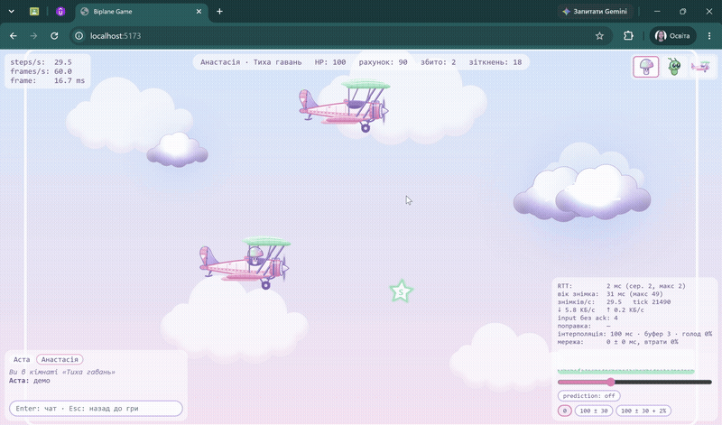
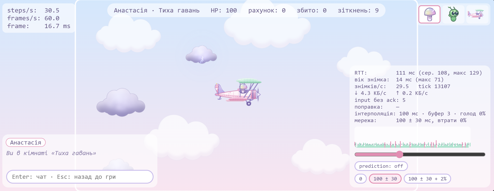
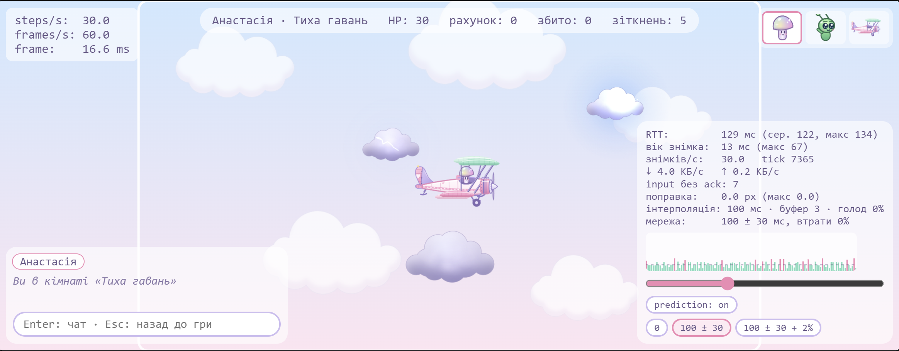
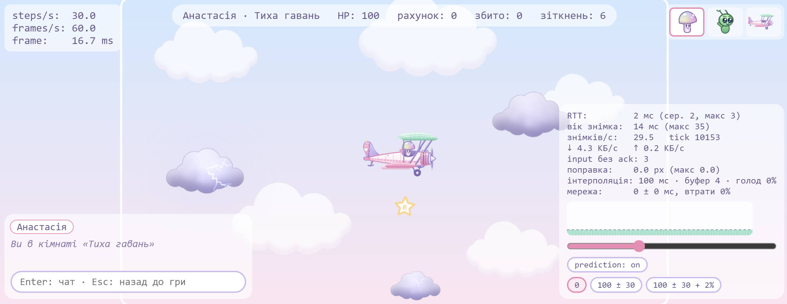

# Biplane Game

Лабораторна робота 5: «Сервер рахує гру: передбачення, звірка і бінарний протокол».

Браузерна гра: пастельний біплан, яким літаєш по арені на canvas.
- [lab-01](https://github.com/Sol777xxx/biplane-game/tree/lab-01): ігровий цикл, фіксований крок, експерименти з event loop.
- [lab-02](https://github.com/Sol777xxx/biplane-game/tree/lab-02): сутності, `World` на `Map`, колізії, кулі, композиція поведінок.
- [lab-03](https://github.com/Sol777xxx/biplane-game/tree/lab-03): пайплайн ассетів, екран завантаження, звук, шина подій, лобі.
- [lab-04](https://github.com/Sol777xxx/biplane-game/tree/lab-04): Node.js сервер, EventEmitter, streams, WebSocket-сервер.

## Запуск

```
npm install
cp server/.env.example server/.env     # PowerShell: Copy-Item server/.env.example server/.env
npm run dev:server                     # термінал 1: сервер на :3000
npm run dev                            # термінал 2: клієнт (Vite) на :5173
```



Потрібен Node.js 24 (див. `.nvmrc`). Перевірка коду: `npx biome check .` · тести: `npm test` (усі три пакети: `client`, `server`, `shared`).

### Штучна мережа

Щоб перевіряти гру при затримці й втратах, додайте в `server/.env` рядок `ENABLE_NETSIM=1` і перезапустіть сервер. Тоді працюють параметри адреси та кнопки в netgraph:

| Параметр | Що робить |
|---|---|
| `?lag=100&jitter=30&loss=2` | штучна мережа на сервері: RTT, розкид, % втрат знімків і input |
| `?interp=100` | затримка інтерполяції чужих сутностей, мс (0–500, за замовчуванням 100) |
| `?smooth=100` | згладжування поправки звірки, мс (0 вимикає, за замовчуванням 100) |
| `?codec=json` | JSON замість бінарного протоколу, для порівняння |
| `?hash` | у консолі хеш симуляції (1000 кроків, seed 1) і хеші перших 20 кроків; `&dump=N` ще й стан сутностей після кроку N |

Без `ENABLE_NETSIM=1` сервер ігнорує `lag`, `jitter` і `loss`, а кнопки пресетів не з'являються.

## Керування

| Клавіша | Дія |
|---|---|
| ← → ↑ ↓ або WASD | рух |
| Пробіл | стрільба |
| H | показати або сховати діагностику (steps/s, frames/s); за замовчуванням схована |
| N | показати або сховати netgraph (RTT, вік знімка, байти/с, поправка…); за замовчуванням схований |
| Enter | відкрити чат; Enter надсилає, Esc повертає керування грі |

У netgraph: кнопка `prediction: on/off`, повзунок затримки інтерполяції і (з `ENABLE_NETSIM=1`) пресети мережі `0`, `100 ± 30`, `100 ± 30 + 2%`; активний пресет підсвічується.

Героя в кабіні обирають на панелі справа вгорі. Адреса з `?debug` відкриває `window.game` і `window.assets` у консолі та показує хітбокси.


## Правила гри

- Хмарки дрейфують і відбиваються від країв; наліт на хмарку знімає 35 HP і знищує її.
- Кулі шкодять хмаркам (знищується за 2–3 влучання, очки = радіус) і кораблям. Біплан, вилетівши за край арени, з'являється з протилежного боку, а куля за межею зникає.
- Над збитою хмаркою спливає «+N» (скільки очок додано).
- Знищений біплан вибухає й відроджується через 2 с у безпечній точці зі щитом на 2 с.
- Pickup'и (зірки): **S** щит, **R** швидкострільність, **H** самонавідні кулі. Частина хмарок наводиться на біплан.
- Параметри арени залежать від кімнати, обраної в лобі (див. розділ «Лобі»).


## Архітектура

```
client/                  усе, що було в лабах 1–3 (Vite, canvas, ассети)
  src/net/
    connection.js        обгортка над WebSocket: черга, reconnect з backoff, бінарні кадри
    roomSession.js       join кімнати поверх connection, seq/ack, ping, netsim
    predictor.js         передбачення свого корабля, звірка, згладжування поправки
    interpolator.js      буфер знімків, чужі сутності малюються на now − delay
    snapshotView.js, events.js   знімок → стан для малювання, події
  src/ui/netgraph.js     панель мережі; src/netStats.js вимірювання
  src/ui/chatPanel.js    чат (textContent, без innerHTML)
  tools/                 dogfight.mjs (боти), random-drift.mjs (дослід з Math.random)
shared/                  код, спільний для клієнта й сервера
  sim/                   симуляція (random.js, hash.js, snapshot.js, scenario.js, …)
  protocol/, codec/      типи повідомлень, binary.js (специфікація в коментарі), json.js
  tools/bench-codec.mjs  JSON проти binary
  test/                  чистота, детермінізм, кодеки, заміри
server/
  src/
    index.js             точка входу: конфіг → сервер → graceful shutdown
    config.js            PORT / HOST / LOG_DIR / MAX_ROOMS / ENABLE_* з оточення, з перевіркою
    app.js               node:http, маршрути, життєвий цикл (listen / close)
    static.js            роздача client/dist: MIME, захист від ..
    api.js, body.js, respond.js, replayRoutes.js   REST, читання тіла, відповіді
    rooms.js             Room і RoomManager (EventEmitter)
    match.js, matches.js гра 30 Гц, черги input, знімки, ack
    netsim.js, stats.js  штучна мережа; лічильники тіків і input
    protocol.js          формат повідомлень, валідація, коди закриття
    ws.js                WebSocket: join, heartbeat, ліміти, повільні клієнти, кодеки
    limits.js            token bucket
    log/matchlog.js      події кімнати → Transform (NDJSON) → pipeline → файл
    log/replay.js        читання NDJSON потоком
  tools/                 chat-client, flood, bigframe, lag-demo
  test/                  node --test
docs/                    demo.gif, скріншоти netgraph
```

## Конфігурація

Читається з оточення (`node --env-file=.env`), перевіряється при старті; усі помилки виводяться разом, процес завершується з кодом 1.

| Змінна | За замовчуванням | Значення |
|---|---|---|
| `PORT` | `3000` | ціле 0–65535 |
| `HOST` | `127.0.0.1` | адреса прослуховування |
| `LOG_DIR` | `./logs` | куди писати журнали матчів |
| `MAX_ROOMS` | `50` | ліміт кімнат на сервері (ціле ≥ 1) |
| `ENABLE_SLOW` | вимкнено | `1` вмикає `/api/slow` (демонстрація блокування, лише для експериментів) |
| `ENABLE_NETSIM` | вимкнено | `1` вмикає штучну затримку й втрати (`?lag`, `?jitter`, `?loss`, повідомлення `netsim`), лише для розробки |
| `CLIENT_DIR` | `client/dist` | що роздавати як статику |

## HTTP API

| Запит | Відповідь |
|---|---|
| `GET /health` | `{ status, uptime, rss, heapUsed }` |
| `GET /api/rooms` | список кімнат |
| `POST /api/rooms` | створює кімнату: `{ name, max?, preset? }`, `201` + `Location`; `503`, якщо досягнуто `MAX_ROOMS` |
| `GET /api/stats` | лічильники матчів: тіки, пропущені тіки (`skipped`), довгі тіки (`overruns`), час тіку, `inputs.repeated` і `inputs.dropped` |
| `GET /api/replays` | список журналів матчів |
| `GET /api/replays/:id` | файл журналу потоком (`application/x-ndjson`) |
| `GET /api/slow?ms=300&mode=block\|sleep` | лише з `ENABLE_SLOW=1`, інакше `404` |

Помилки це JSON з тим самим статусом: `400` (погане тіло/параметри), `404`, `405` (з `Allow`), `413` (тіло > 1 КБ), `415` (не JSON).
Статика: шлях із `..` дає `403`, зламане `%`-кодування `400`; перевірка йде за сирим `req.url`, бо `URL` сам «нормалізує» `/../`.

## Протокол WebSocket

Текстові повідомлення це JSON з `v: 1` і `type`. Набір полів **строгий**: зайве чи відсутнє поле це порушення протоколу. Бінарними можуть бути лише `input` (клієнт → сервер) і `snapshot` (сервер → клієнт).

| Напрямок | `type` | Поля |
|---|---|---|
| клієнт → сервер | `join` | `room` (`[\w-]{1,32}`), `name` (1–16 символів) |
| клієнт → сервер | `chat` | `text` (1–200 символів) |
| клієнт → сервер | `input` | `seq`, `up`, `down`, `left`, `right`, `fire`; JSON або бінарний (7 байт) |
| клієнт → сервер | `ping` | `t` |
| клієнт → сервер | `netsim` | `lag`, `jitter`, `loss` (з `ENABLE_NETSIM=1`, інакше сервер відповідає `enabled: false`) |
| клієнт → сервер | `leave` | немає |
| сервер → клієнт | `joined` | `you`, `room`, `players` |
| сервер → клієнт | `roster` | `players` |
| сервер → клієнт | `snapshot` | `tick`, `ack`, кораблі, хмарки, кулі, бонуси, події; бінарний за замовчуванням, JSON з `?codec=json` |
| сервер → клієнт | `pong` | `t` |
| сервер → клієнт | `netsim` | `enabled`, `lag`, `jitter`, `loss` |
| сервер → клієнт | `chat` | `name`, `text` |
| сервер → клієнт | `error` | `code`, `message` (після нього сокет закривається) |

Клієнт шле лише п'ять булевих клавіш і `seq`; позиції чи швидкості в протоколі немає. Сервер у кожному знімку повертає `ack`: `seq` останнього input цього гравця, який він обробив.

Перше повідомлення мусить бути `join` і прийти за 5 с. Порушення закриває сокет із кодом:

| Код | Причина | Клієнт перепідключається? |
|---|---|---|
| 1000 | нормальне закриття (`leave`) | ні |
| 1001 | сервер зупиняється | так |
| 1003 | бінарний кадр з чужою версією (перший байт не 1) | ні |
| 1009 | кадр більший за `maxPayload` (2048 Б) | ні |
| 1011 | внутрішня помилка | так |
| 4000 | не JSON, чужа версія, зайве чи погане поле, зламана розкладка бінарного input | ні |
| 4001 | невідомий `type` | ні |
| 4002 | `join` не прийшов за 5 с | ні |
| 4003 | повідомлення до `join` | ні |
| 4004 | повторний `join` | ні |
| 4005 | кімнати немає | ні |
| 4006 | кімната заповнена | ні |
| 4007 | ім'я зайняте | так, після першого успішного join (сервер ще міг не прибрати мертвий сокет) |
| 4008 | перевищено ліміт повідомлень | ні |
| 4009 | клієнт надто повільний | ні |

### Бінарний формат

Little-endian скрізь, кадр починається з байтів «версія, тип». Повна специфікація в коментарі на початку `shared/codec/binary.js`. Розміри: заголовок знімка 17 байт, гравець 11 + довжина id, корабель 33, хмарка 22, бонус 14, куля 27, подія до 10. Input рівно 7 байт. Кут `pitch` це `Int16` у десятитисячних частках радіана. Id сутностей це `u32`, а не `u16`: лічильник id росте всю гру, і `u16` переповнився б після 65 536 куль. Декодер строгий: обрізаний кадр, зайві байти чи чужа версія дають `CodecError`, а не тихе сміття.

### Життя з'єднання

- **Heartbeat**: сервер шле `ping` раз на 15 с; два пропущені `pong` поспіль і сокет рветься (`terminate`). Без цього «мертві» з'єднання (клієнт зник без `close`) жили б вічно і тримали місце в кімнаті.
- **Клієнт** (`connection.js`): повідомлення, надіслані до відкриття, стоять у черзі; після `open` спершу йде `join`, потім решта. Reconnect з exponential backoff і jitter. Закриття, ініційоване користувачем, повторів не викликає. Бінарний input у закритому з'єднанні не стає в чергу (старий input був би марним).
- **Graceful shutdown**: `SIGINT` / `SIGTERM` → `server.close()`, сокетам `1001`, після 3 с решта з'єднань рубається. Порядок закриття: кімнати → сокети → журнали матчів (щоб події виходу гравців потрапили у файл). Код виходу 0.

## Кімнати: `EventEmitter`

`Room extends EventEmitter` не знає про сокети; кожен сокет підписується на події сам і відписується при закритті.

| Подія | Коли |
|---|---|
| `join`, `leave`, `chat` | гравець зайшов, вийшов, написав |
| `input` | прийшов input гравця (його слухає `Match`) |
| `matchstart` | зайшов перший гравець у порожню кімнату |
| `empty` | вийшов останній (`RoomManager` видаляє непостійну кімнату) |
| `event` | кожна з подій вище в єдиному форматі `{ t, type, … }`, джерело для журналу |

`RoomManager extends EventEmitter` кидає `created`. Кімната, куди ніхто не зайшов, видаляється через 60 с, інакше `POST /api/rooms` створював би їх назавжди.
Кімнати не емітують `"error"`: помилки валідації це виключення з `RoomError`, а не подія без слухача.

## Журнал матчу і повтор: потоки

```
room "event" → NdjsonTransform (objectMode) → createWriteStream(<LOG_DIR>/<room>-<час>.ndjson)
```

`pipeline` з'єднує ланки й передає помилку з будь-якої на всі. Матч це період, коли в кімнаті є хоча б один гравець: `match_start` … `match_end`, по рядку JSON на подію.
`GET /api/replays/:id` віддає файл через `pipeline(createReadStream, res)`, а `replay.js` читає його як асинхронний генератор (`readEvents`), складаючи шматки в рядки. Id перевіряється регулярним виразом `^[\w-]{1,128}$` за сирим шляхом, тож вийти з `LOG_DIR` неможливо.

## Захист від зловживань

| Загроза | Захист |
|---|---|
| сплеск повідомлень | три token bucket на з'єднання: усі кадри 90 + 60/с, керування (`join`, `chat`, `ping`, `netsim`) 10 + 5/с, `input` 60 + 40/с; перевищення це `4008` |
| величезний кадр | `maxPayload` 2048 Б: `ws` відкидає кадр до того, як зібрати його в пам'ять (`1009`) |
| сміття замість JSON чи бінарного кадру | строга валідація, ключі типу `__proto__` / `toString` відхиляються через `Object.hasOwn`; чужа версія бінарного кадру `1003`, зламана розкладка `4000` |
| підроблені дані гравця | у протоколі немає позицій чи швидкостей: клієнт шле лише клавіші й `seq`; перезарядка й швидкість живуть на сервері |
| забагато кімнат | `MAX_ROOMS` (`503` на `POST`) |
| забагато гравців | `max` кімнати (1–8), `4006` |
| «німий» клієнт | таймер `join` 5 с, heartbeat |
| повільний клієнт | політика за `ws.bufferedAmount`, див. нижче |
| штучна мережа в проді | `ENABLE_NETSIM` вимкнено за замовчуванням, параметри `lag/jitter/loss` ігноруються |
| важка відповідь у пам'ять | журнали віддаються потоком, тіло запиту обмежене 1 КБ |

**Повільний клієнт.** Якщо клієнт не читає, байти копляться в буфері сокета, а при розсилці на N клієнтів це N копій. Є два пороги: вище 16 КБ сервер перестає слати цьому клієнтові `chat` (потік, втрата одного повідомлення не ламає стан); вище 256 КБ з'єднання закривається кодом `4009`. `roster` не відкидається, бо це стан, а не потік. Якщо клієнт не прочитає навіть `close`-кадр, через 1 с сокет рветься примусово.

---
# Сервер рахує гру: передбачення, звірка і бінарний протокол
 У грі одну гру рахує сервер: клієнт шле `input` (п'ять клавіш і `seq`), сервер 30 разів на секунду рахує світ і розсилає знімки. Щоб гра не «гальмувала» при затримці, клієнт передбачає свій корабель, а чужі малює з інтерполяцією.

## Як це влаштовано

| Частина | Що робить |
|---|---|
| `shared/sim` | та сама симуляція в браузері й Node: фіксований крок, генератор `mulberry32` із seed від сервера, без `Math.random`, `Date.now` і DOM |
| `shared/protocol`, `shared/codec` | типи повідомлень, JSON-кодек і бінарний кодек на `DataView` |
| `server/src/match.js` | 30 Гц за абсолютним цільовим часом (`setTimeout`, не `setInterval`), черги input, `ack`, знімки |
| `server/src/netsim.js` | затримка, розкид і втрати на шляху повідомлень |
| `client/src/net/predictor.js` | передбачення свого корабля й куль, звірка з повтором input, згладжування поправки |
| `client/src/net/interpolator.js` | буфер знімків, чужі сутності малюються на `now − delay` |
| `client/src/ui/netgraph.js` | RTT, вік знімка, байти/с, input без `ack`, поправка |

Потік даних: клавіші → `input {seq}` → сервер бере по одному input за тік і рахує світ → знімок із `tick` і `ack` → клієнт скидає свій корабель у стан сервера, відкидає input з `seq ≤ ack` і заново програє решту.

## Що показали вимірювання

Усі числа нижче з моїх запусків (Node v24.13.0, Windows, Intel Core i7-12700H). `dogfight` це два боти на справжньому клієнтському коді, кожен прогін 10 с після 2 с розігріву, тож це одиничні короткі прогони, і між прогонами є шум (наприклад, p95 інтервалу між знімками при тих самих умовах коливається приблизно від 50 до 64 мс).

### Затримка

З `lag=100, jitter=30` виміряний RTT у netgraph: 111 мс (середнє 115, максимум 134);  у `dogfight` середній RTT 117–120 мс (максимум до 147 мс). Без передбачення корабель має чекати відповіді сервера, тож реакція на клавішу приходить не раніше ніж через RTT (≈115 мс) плюс до одного тіку сервера (до 33 мс). З передбаченням клавіша застосовується локально в тому ж кадрі;  сервер лише підтверджує її за RTT. Це випливає з побудови, а не з окремого виміру часу реакції. Без штучної мережі RTT 1–3 мс. 

### Поправки звірки

| Прогін (10 с, 2 бота) | RTT сер., мс | поправка сер., px | поправка макс, px | поправок >1 px | input повторено | input відкинуто |
|---|---|---|---|---|---|---|
| `lag 0, jitter 0, втрати 0%` | 1,1–1,3 | 2,16–2,17 | 12,0 | 22,3% | 157 | 0 |
| `lag 100 ± 30, втрати 2%` | 117–120 | 2,45–3,26 | 12,0–24,0 | 24–32% | 180 | 0 |

Поправки є навіть без затримки й втрат: середня 2,2 px, максимум 12 px. При цьому сервер за 360 тіків повторив попередні клавіші 157 разів (черга input була порожня), а відкинутих input немає. У цій грі зіткнення й кулі змінюють лише HP, а не рух, тож зіткнення поправок не дають. Дані відповідають такому поясненню: сервер у тіку не знайшов нового input і повторив попередній, а клієнт уже передбачив новий. Прямого експерименту (вимкнути повтор і подивитися, чи зникнуть поправки) я не робила, тому це пояснення, а не доведений факт. Відродження (новий корабель скидається без поправки) і втрачені input можуть давати поправки теж, але окремо їх я не міряла.

**Згладжування.** Розмір поправки від згладжування не залежить: `--smooth 100` дало середню 2,45–3,26 px, `--smooth 0` 2,57–2,72 px (максимум 12 px в обох). Згладжування змінює лише те, як поправка малюється на екрані, а цієї таблиці для цього замало, тож користь згладжування цими вимірами не підтверджена.

### Детермінізм

Хеш стану після 1000 кроків (`seed 1`, 2 гравці) однаковий у Node і в Chrome: `d68b1ebf` (`npm test` у `shared` і `?hash` у браузері).

**Баг, на який я натрапила.** Спершу хеш рахувався за точними бітами чисел, і результати розійшлися: Node `f4912b4d`, Chrome `1e48f5fd`. `?hash&dump=4` показав, що на кроці 4 з усього стану відрізняється одне число: `vel.y` однієї хмарки (`-4.828323745910022` у Node, `-4.828323745910023` у Chrome), тобто різниця в останньому біті. Позиції при цьому однакові, і на частині кроків хеші знову збігалися. Швидкість самонавідних хмарок перераховується через `atan2`, `sin` і `cos`; я припускаю, що саме ці функції у двох збірках V8 можуть різнитися в останньому біті, але виклик, який дає різницю, я окремо не ізолювала. Тому `hashGame` тепер округлює кожне число до 1e-6, перш ніж хешувати: шум останнього біта зникає, а розбіжність стану від 1e-6 і вище все ще змінює хеш. Після цього хеші збіглися на всіх 20 перших кроках і на кроці 1000.

**Тести детермінізму:** однаковий seed і input дають однаковий хеш, інший seed або кількість гравців дають інший; дві симуляції збігаються на кожному кроці; тест чистоти підміняє `Math.random`, `Date.now` і `performance.now` функціями-винятками й проганяє симуляцію, тож додавання їх у `shared/sim` одразу зламає тест.

**Дослід з `Math.random`.** `npm run drift` додає `Math.random()` у рух корабля (±60 px/с) на клієнті, не змінюючи `shared`, і міряє поправки при RTT 0, 100 і 200 мс (px):

| `Math.random` у update | RTT, мс | n | середня | p95 | макс |
|---|---|---|---|---|---|
| ні | 0 | 899 | 0,01 | 0,01 | 0,01 |
| ні | 100 | 897 | 0,01 | 0,01 | 5,09 |
| ні | 200 | 896 | 0,02 | 0,01 | 7,05 |
| ±60 px/с | 0 | 899 | 0 | 0,01 | 0,01 |
| ±60 px/с | 100 | 897 | 5,74 | 14,17 | 24,11 |
| ±60 px/с | 200 | 896 | 8,85 | 22,14 | 40,95 |

Без недетермінізму поправки майже нульові (p95 0,01 px; поодинокі викиди 5–7 px). З випадковістю вони ростуть разом з RTT: середня 5,74 px при 100 мс і 8,85 px при 200 мс. При RTT 0 різниці немає, бо сервер відповідає майже миттєво й розбіжність не встигає накопичитися.

### Інтерполяція

Затримка 100 мс за замовчуванням (методичка радить близько двох інтервалів між знімками; я взяла три). `dogfight` при `lag 100 ± 30`, втрати 2%:

| Інтерполяція | голод буфера | чужий корабель стоїть | `крок p95`, px |
|---|---|---|---|
| 0 мс (`--interp 0`) | 100% | 41,7–43,4% часу | 13,7 і 20,1 |
| 100 мс | 0–0,6% | 0–0,3% часу | 11,5 і 11,5 |

Без інтерполяції чужий корабель малюється за найновішим знімком, тож майже половину часу стоїть і рухається ривками (метрика `крок p95` 13,7 і 20,1 px проти 11,5 px). Зі 100 мс буфер майже не вичерпується. Інтервал між знімками у тих самих прогонах: p95 50–64 мс, максимум 78–112 мс, тож 100 мс перекриває p95 і майже всі прогалини при втраті знімків. Значень 50 і 200 мс я не вимірювала. Компроміс: чужі кораблі видно на 100 мс у минулому.

### JSON проти binary

`node shared/tools/bench-codec.mjs`: 4 гравці, 30 Гц, 1800 тіків після розігріву 120, seed 1. У середньому в знімку: кораблів 3,5, хмарок 2,2, куль 5,4, бонусів 0,6, подій 0,5.

| Кодек | Байт/знімок | КБ/с на клієнта (вниз) | КБ/с на клієнта (вгору) | encode+decode, мкс |
|---|---:|---:|---:|---:|
| JSON | 1577 | 46,22 | 2,77 | 21,8 |
| Binary (`DataView`) | 389 | 11,40 | 0,21 | 12,5 |

Знімок у binary менший у 4,1 раза, input у 13,5 раза.

| Кодек | Знімок мін, байт | p95 | макс | encode, мкс | decode, мкс | Input, байт | Input encode+decode, мкс |
|---|---:|---:|---:|---:|---:|---:|---:|
| JSON | 979 | 1966 | 2384 | 14,5 | 11,9 | 94 | 1,45 |
| Binary (`DataView`) | 217 | 497 | 609 | 5,8 | 6,2 | 7 | 1,40 |

Примітки: розмір це корисне навантаження кадру без заголовків WebSocket і TCP; KB/s = байт × 30 / 1024; час це медіана з 7 раундів по 10 проходів, один потік. У сценарії гравці стріляють приблизно половину часу, у реальній грі куль зазвичай менше.

У живому прогоні `dogfight` (2 боти) канал вниз binary це 6,6–8,8 КБ/с, JSON 30,1 КБ/с, а вгору 0,2 і 2,3 КБ/с відповідно. Різні абсолютні числа в bench і в `dogfight` природні: у `dogfight` менше сутностей і куль, ніж у сценарії bench.

### Сервер і тік

У всіх прогонах `dogfight` сервер не пропустив жодного тіку (`skipped 0`, довгих тіків `0`), максимальний час тіку 1,5–9,7 мс при бюджеті 33,3 мс.

### Чіти

Клієнт шле лише п'ять булевих клавіш і `seq`: позиції чи швидкості в протоколі немає, тож телепорт неможливий за побудовою. Швидкість обмежена симуляцією, перезарядка пострілу живе на сервері. Зламане повідомлення закриває з'єднання (`4000`), а потік input обмежений відром. Що лишається клієнту: спамити input у межах ліміту й автоматично цілитися. Компенсації лагу немає (Stretch не робила): сервер вирішує влучання в моменті свого часу, тож хмарка після власного влучання зникає приблизно через RTT.

## Відтворити

```powershell
# боти на справжньому клієнтському коді (сервер піднімається в процесі)
npm run dogfight -w client
npm run dogfight -w client -- --lag 0 --jitter 0 --loss 0
npm run dogfight -w client -- --interp 0
npm run dogfight -w client -- --smooth 0
npm run dogfight -w client -- --binary 0

# експеримент з Math.random у update (без правки shared)
npm run drift -w client

# JSON проти binary
npm run bench -w shared

# хеш детермінізму: рядок "hash (1000 кроків, seed 1)" у виводі, і те саме в Chrome з ?hash
npm test -w shared
```

## Reflection

1. **Чому сервер авторитетний.** Клієнт-авторитетний дизайн має дві проблеми: довіра (клієнт бреше) і узгодженість (дрейф чисел, втрачені пакети, кожен бачить свою гру). Експлойт: надіслати `x` і `y` з DevTools і телепортуватися. У нашому протоколі це неможливо: повідомлення з зайвим полем закриває з'єднання `4000`.
2. **Передбачення.** Клієнт одразу застосовує свій input до свого корабля тим самим `Biplane.update`, що й сервер. Це працює лише завдяки детермінізму: однаковий стан і input дають однаковий результат. Порушення видно як ріст поправки в netgraph: у досліді з `Math.random` середня поправка при RTT 100 мс виросла з 0,01 до 5,74 px.
3. **Звірка за прикладом.** Клієнт на тіку 104, прийшов знімок тіку 100 з `ack` 57, у буфері `seq` 55–61.
   1. Відкидаємо `seq ≤ 57`: лишаються 58–61, чотири input.
   2. Ставимо корабель у стан сервера для тіку 100 разом зі швидкістю, нахилом, перезарядкою й ефектами.
   3. Програємо 58, 59, 60, 61 по порядку з `TICK_DT`.
   4. Корабель знову в тіку 104. Різниця між старою й новою позицією це поправка. Видимий зсув згасає за ≈100 мс, тож перескоку немає.
4. **Інтерполяція в минулому.** Знімки приходять дискретно й з джитером, тож для плавного руху потрібна пара знімків, яка охоплює момент малювання. Затримка це плата за плавність: менша дає «голод» буфера й ривки при втратах (у `dogfight` без неї чужий корабель стояв ≈42% часу), більша відкладає чужі кораблі. Обрано 100 мс.
5. **Компенсація лагу.** Гравець цілиться в те, що бачить, а це чужий корабель із минулого (затримка мережі плюс інтерполяція). Сервер рахує влучання в «зараз», тому цілитись довелося б із упередженням. Компенсація лагу перематає світ на момент, який бачив стрілець. У нас її немає.
6. **`DataView` проти `Float32Array`.** `DataView` читає будь-який тип за будь-яким зсувом із явним порядком байтів, тож підходить для змішаних форматів. `Float32Array` це однорідні вирівняні дані в порядку байтів платформи й підходить для масового доступу. У протоколі порядок байтів критичний, бо відправник і одержувач можуть мати різні платформи. Для локального typed array його читає та сама машина.
7. **Кут як `Int16`.** Крок 0.0001 рад (≈ 0.0057°), на носі (96 px) це ≈ 0.01 px. Діапазон ±3.2767 рад при нахилі максимум 0.45 рад з великим запасом. Тест кодека перевіряє похибку ≤ 0.00005 рад.
8. **Тік без `setInterval`.** `setInterval` дрейфує, і затримки накопичуються. Схема `nextTick += 1000/30; setTimeout(nextTick − now)` рахує від абсолютної мітки, тож помилка не накопичується. При перевитраті сервер наздоганяє до 5 тіків, решту пропускає й рахує (`skipped`, `overruns` у `/api/stats`).
9. **Недетерміновані джерела.** `Math.random` дає клієнту й серверу різні числа, і поправки ростуть (див. таблицю). `Date.now` залежить від годинника машини, а не від кроку симуляції. `Set` у JS ітерується в порядку вставки, тому він детермінований, якщо обидві сторони вставляють однаково. Ламає його різний порядок вставки: тому світ у нас це `Map` з id від лічильника світу, а передбачені кулі клієнта живуть окремо від спільного світу. Окремо `Math.sin`, `cos` і `atan2` не гарантують однакових останніх бітів у різних збірках рушія: з цієї причини `hashGame` округляє числа до 1e-6.