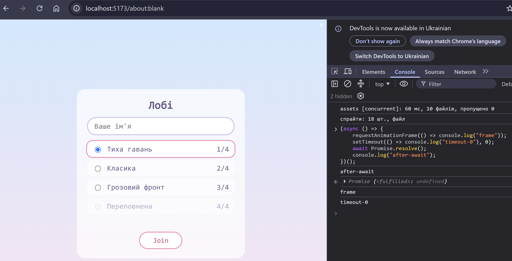
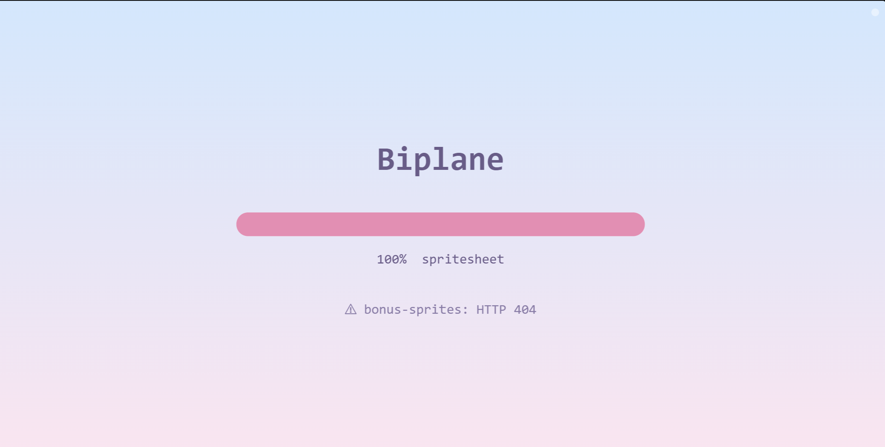
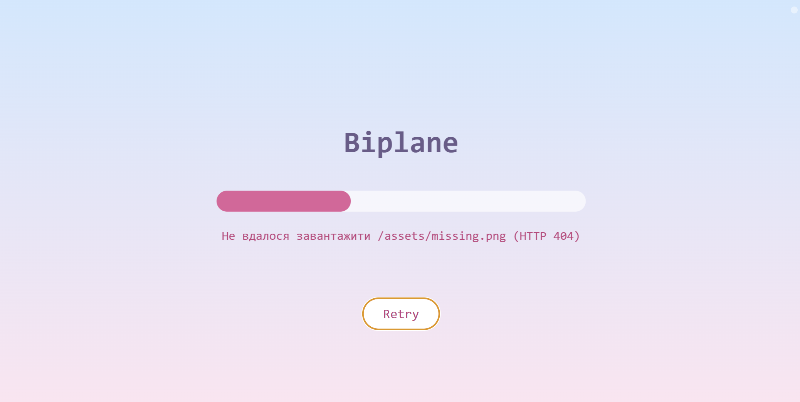
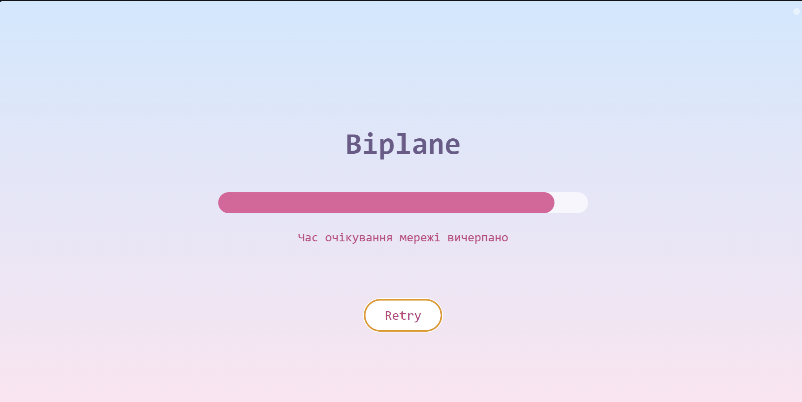
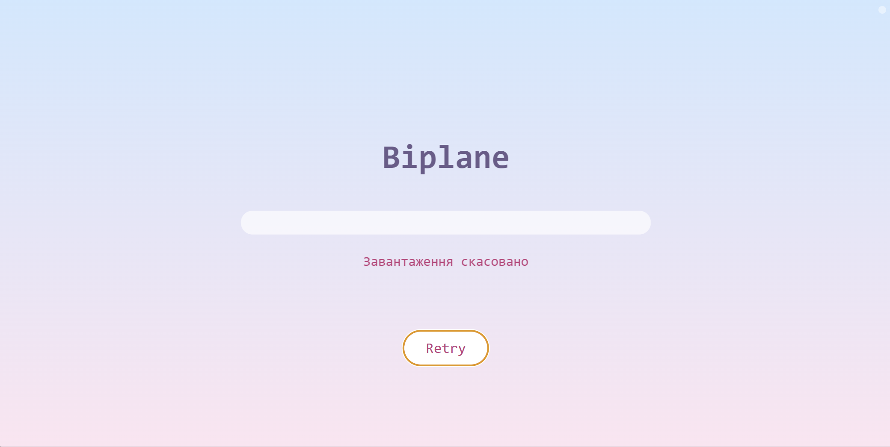
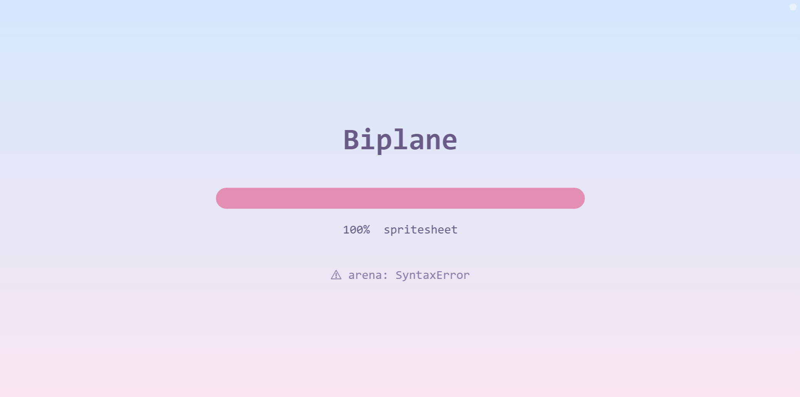
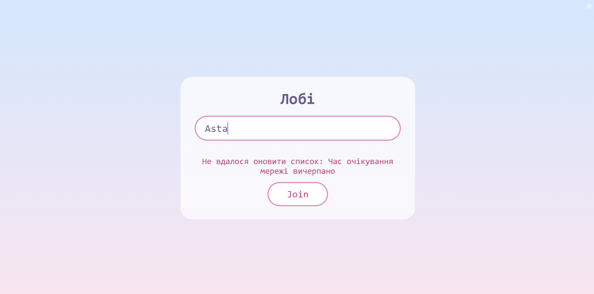

# Biplane Game

Лабораторна робота 3: «Асинхронний JavaScript: Promises, async/await і екран завантаження».

Браузерна гра: пастельний біплан, яким літаєш по арені на canvas.
- [lab-01](https://github.com/Sol777xxx/biplane-game/tree/lab-01): ігровий цикл, фіксований крок, експерименти з event loop.
- [lab-02](https://github.com/Sol777xxx/biplane-game/tree/lab-02): сутності, `World` на `Map`, колізії, кулі, композиція поведінок.

## Запуск

```
npm install
npm run dev
```

Потрібен Node.js 24 (див. `.nvmrc`). Гра: `http://localhost:5173/`.
Перевірка коду: `npx biome check .` · тести: `npm test` · порівняння sequential/concurrent: `npm run timing` · головоломки: `npm run puzzles`.

## Керування

| Клавіша | Дія |
|---|---|
| ← → ↑ ↓ або WASD | рух |
| Пробіл | стрільба |
| H | показати або сховати HUD |
| P | вимірювання (лаба 1): 5 с польоту вправо, результат у консолі |

Героя в кабіні обирають на панелі справа вгорі. Адреса з `?debug` відкриває `window.game` і `window.assets` у консолі та показує хітбокси.

Параметри адреси лаби 3: `?latency=300` (затримка на кожен файл), `?seq` (завантажувати по черзі), `?chaos=…` (навмисні збої, див. галерею), `?delay=5000` (затримка відповіді лобі), `?bake` (зберегти спрайтшит).

## Правила гри

- Хмарки дрейфують і відбиваються від країв; наліт на хмарку знімає 35 HP і знищує її.
- Кулі шкодять хмаркам (знищується за 2–3 влучання, очки = радіус) і кораблям. Біплан, вилетівши за край арени, з'являється з протилежного боку, а куля за межею зникає.
- Над збитою хмаркою спливає «+N» (скільки очок додано).
- Знищений біплан вибухає й відроджується через 2 с у безпечній точці зі щитом на 2 с.
- Pickup'и (зірки): **S** щит, **R** швидкострільність, **H** самонавідні кулі. Частина хмарок наводиться на біплан.
- Параметри арени залежать від кімнати, обраної в лобі (див. розділ «Лобі»).

## Архітектура

```
demo/
  timing.mjs     sequential vs Promise.all на однакових «файлах»
  puzzles.mjs    п'ять головоломок порядку мікрозадач і задач
public/
  api/rooms.json     список кімнат (лаба 4 замінить це сервером)
  assets/            manifest.json, arena.json, sprites.png/json, звуки .wav
src/
  assets/
    loader.js    fetch + перевірка ok, retry з backoff і jitter, loadAll
    audio/       Web Audio: AudioContext, буфери, підписка на world.bus
  loadingScreen.js  прогрес-бар на canvas, повідомлення, Retry
  lobby.js       class Lobby extends EventTarget (без DOM)
  hud.js         спливаючі «+N», підписка на world.bus
  loop.js        ігровий цикл (rAF + акумулятор)
  input.js       клавіатура як замикання
  main.js        loading → лобі → гра
  sim/           модель світу без DOM (див. lab-02), world.bus, resolveArena
  render/        малювання на canvas, sprites.js (атлас + запікання)
  ui/            панель вибору героя, lobbyView.js (DOM лобі)
test/            loader, bus, hud, config, lobby (node --test)
tools/           make-sounds.mjs (синтез .wav без зовнішніх файлів)
```

Сим як і раніше не знає про DOM, а тепер не знає й про звук та HUD: вони підписані на `world.bus`.

## Потік запуску

```
loading → лобі → гра
```
1. **loading**: `manifest.json` (через `withRetry`) → `loadAll` вантажить спрайти, звуки й `arena.json` паралельно; прогрес-бар рахує готові файли.
2. **лобі**: `GET /api/rooms`, гравець вводить ім'я й обирає кімнату.
3. **гра**: клік по Join це жест гравця, тож саме там розблоковується `AudioContext`, і перший постріл уже зі звуком.

Конфіг арени збирається шарами: значення за замовчуванням ← `arena.json` ← `arena` вибраної кімнати
(`resolveArena` у `sim/game.js`, значення обмежуються діапазонами, сміття ігнорується).

## Пайплайн ассетів

### У чому проблема

`fetch` відхиляє проміс лише при мережевій помилці. Відповідь `404` для нього успішна: проміс виконується, просто `res.ok === false`.
Тому `await fetch(url)` без перевірки «успішно» завантажує сторінку помилки, а далі код падає або мовчки працює з сміттям.
Уся перевірка зроблена в одному місці: `fetchResponse` кидає `HttpError(status, url)`, а `fetchJson`, `loadImage` і `loadAudio`
користуються тільки ним. Прямого `fetch` в решті коду немає.

Dev-сервер Vite для неіснуючого файлу віддає `index.html` зі статусом 200, тож 404 довелося відтворювати в `vite.config.js`: інакше жоден збій у галереї не спрацював би.

### Які помилки повторюємо

| Помилка | `name` | Повтор? | Чому |
|---|---|---|---|
| мережа недоступна | `TypeError` | так | тимчасовий збій |
| час вийшов | `TimeoutError` | так | сервер міг просто не встигнути |
| `5xx` | `HttpError` | так | збій на боці сервера |
| `4xx` | `HttpError` | **ні** | помилка запиту: повтор дасть те саме |
| битий JSON | `SyntaxError` | **ні** | файл не виправиться сам |
| скасовано | `AbortError` | **ні** | гравець сам так вирішив |

Пауза між спробами: exponential backoff з full jitter, `random() * min(maxMs, baseMs * 2^(n-1))`.
Експонента не дає забивати сервер, що ледве дихає, а jitter розводить повтори різних клієнтів у часі,
щоб вони не прийшли всі разом. У тесті `random` підміняється на `() => 1`, і видно верхню межу: `100, 200, 350` (при `maxMs = 350`).

### Опційні ассети

У маніфесті запис може бути `optional` (з `fallback`). Якщо такий ассет не завантажився, `loadAll` не падає, а кладе
`fallback` (або `null`) і додає запис у `failures`. Екран завантаження показує його як «⚠», гра стартує.
Обов'язковий ассет, що впав, відхиляє `loadAll`, і гравець бачить помилку та кнопку Retry.
Усі звуки й спрайти опційні: без файлу `audio.js` бере інший звук зі зміною тону, а `sprites.js` запікає атлас у пам'яті.

## Sequential `await` vs `Promise.all`

`npm run timing`: 8 файлів, на сервері штучна затримка 250 мс на кожен, три прогони.

```
sequential 2045, 2023, 2011 мс, середнє 2026 мс
concurrent 258, 257, 255 мс, середнє 257 мс
різниця: ×7.9 (8 файлів по 250 мс)
```

| Режим | Прогони, мс | Середнє |
|---|---|---|
| sequential (`await` у циклі) | 2045, 2023, 2011 | 2026 мс |
| concurrent (`Promise.all`) | 258, 257, 255 | 257 мс |

Sequential це **сума** затримок (8 × 250), бо наступний запит стартує, лише коли завершився попередній.
Concurrent це **максимум** (≈ 250 мс плюс накладні витрати): усі запити летять одночасно, `Promise.all` чекає на найповільніший.

У браузері: `/?latency=300` проти `/?latency=300&seq`, час у рядку `assets [...]` в консолі.

### Який комбінатор для чого

| Комбінатор | Поведінка | Де підходить |
|---|---|---|
| `Promise.all` | відхиляється, щойно впав **перший** | усі потрібні, збій одного робить решту марною (наш `loadAll`) |
| `Promise.allSettled` | чекає всіх, віддає статус кожного | потрібен звіт про все, нічого не скасовуємо |
| `Promise.race` | перший завершений, успіх чи помилка | таймаут: «запит або таймер» |
| `Promise.any` | перший **успішний** | дзеркала одного файлу: береться найшвидше |

`loadAll` бере `Promise.all`, а м'якість до опційних ассетів забезпечує `settle` (він ловить помилку всередині і повертає `fallback`).
Побічний ефект `Promise.all`: коли обов'язковий ассет упав, решта запитів сама не зупиняється, тому `loadAll`
скасовує їх внутрішнім `AbortController`. Тест перевіряє, що відхилення приходить швидше за 1 с, хоча повільний запит триває 3 с.

## Скасування: AbortController і AbortSignal

- Кожен запит приймає `signal`. `fetchResponse` склеює його з `AbortSignal.timeout(timeoutMs)` через `AbortSignal.any`, тож запит
  зупиняється і від скасування, і від таймауту. Таймаут охоплює весь запит разом із читанням тіла.
- Таймаут дає `TimeoutError`, ручне скасування `AbortError`. За цією різницею `isRetryable` повторює перше і не чіпає друге.
- `sleep(ms, signal)` і пауза між повторами теж скасовуються: Retry не «дочекається» таймера, коли гравець уже пішов.
- У лобі кожен запит має власний `AbortController`, і `stop()` обриває той, що ще летить. У DevTools → Network він стає `(canceled)`.
- DOM-слухачі лобі підписані з одним `signal`, тож один `abort()` знімає їх усі.

## Шина подій і HUD

`world.bus` це `EventTarget`, єдиний канал від симуляції до решти. Сим кидає `CustomEvent`, не знаючи, хто слухає:

| Подія | Коли | Хто слухає |
|---|---|---|
| `fired` | постріл | audio |
| `hit` | куля влучила | audio |
| `exploded` | знищено хмарку або літак | audio |
| `crash` | хмарка врізалась у літак | audio |
| `pickup` | підібрано зірку | audio |
| `respawned` | літак відродився | audio |
| `scored` | збито хмарку, `{ delta, total, at }` | hud (спливаюче «+N») |

`audio.js` і `hud.js` самі підписуються на шину; `test/bus.test.mjs` перевіряє, що файли в `src/sim/` не імпортують audio і hud.
Новий підписник (лічильник, тряска екрана) додається без змін у сімі.

`AudioContext` створюється на старті, щоб `decodeAudioData` декодував звуки ще на екрані завантаження, а не під час першого пострілу.
Запускається контекст лише після жесту гравця (політика автозапуску браузерів).

## Спрайтшит

Кораблі, кулі, pickup-зірки й хмарки малюються з атласу `public/assets/sprites.png` + `sprites.json`,
який завантажується через `loadAll` як `image` і `json`. Атлас згенерований тими самими draw-функціями:
відкрийте гру з `?bake`, і браузер завантажить обидва файли. Якщо файлів немає (404), `initSprites`
запікає такий самий атлас у пам'яті, тож гра стартує, а екран завантаження показує попередження. Це також один зі збоїв галереї.
Блискавки, щит, частинки й вибухи динамічні, тому лишаються процедурними.

## Лобі

`Lobby extends EventTarget` (`src/lobby.js`) не знає про DOM: раз на 3 с робить `GET /api/rooms`
і кидає події `rooms` / `error` / `join`. DOM лобі окремо, в `src/ui/lobbyView.js`.

- Кожен запит має `AbortSignal.timeout` (2 с) і власний `AbortController`.
- Наступний запит планується після завершення попереднього (а не `setInterval`), тож запити не накладаються.
- Щойно гравець натиснув Join (або вкладка стала фоновою), `stop()` обриває запит, що ще летить, і нових не буде.
- `join(name, roomId)` перевіряє ім'я, існування кімнати й що вона не заповнена, зупиняє опитування й кидає `join`.
- Ім'я запам'ятовується в `localStorage`.

Кімнати лежать у `public/api/rooms.json` (dev-middleware Vite віддає їх за `/api/rooms`, лаба 4 замінить це справжнім сервером):

| Кімната | Хмарок | Зірка кожні, с | Самонаведення | Швидкість | Нова хмарка через, с |
|---|---|---|---|---|---|
| Тиха гавань | 3 | 8 | 0 | 1 | 3 |
| Класика | 5 | 8 | 0,3 | 1 | 2 |
| Грозовий фронт | 8 | 10 | 0,6 | 1,3 | 0,6 |
| Переповнена | 5 | 8 | 0,3 | 1 | 2 (місць немає) |

Перевірка таймауту: `?delay=5000` у адресі гри затримує відповідь лобі, і через 2 с видно повідомлення про час очікування.

## Головоломки: мікрозадачі проти задач

Правило: після кожної синхронної частини event loop спорожняє **всю** чергу мікрозадач (`then`, `await`, `queueMicrotask`),
і лише потім бере наступну задачу (`setTimeout`, `requestAnimationFrame`). Мікрозадачі, додані під час мікрозадач, виконуються в тому ж проході.

Відтворити: `npm run puzzles` (`demo/puzzles.mjs`). Очікуваний вивід:

```
1: sync-1, sync-2, then, timeout
2: f-start, sync, f-after-await, then
3: then-1, nested-then, then-2, timeout-outer, timeout-in-then
4: executor, after-resolve, then ok, after-await, microtask
5: after-await, timeout-0, frame
```

### 1. `then` проти `setTimeout`

```js
console.log("sync-1");
setTimeout(() => console.log("timeout"), 0);
Promise.resolve().then(() => console.log("then"));
console.log("sync-2");
```

Вивід: `sync-1`, `sync-2`, `then`, `timeout`.
Спочатку весь синхронний код, потім мікрозадача `then`, і лише потім задача таймера, хоч він і з 0 мс.

### 2. Обов'язковий `await`

```js
async function f() {
  console.log("f-start");
  await null;
  console.log("f-after-await");
}
f();
Promise.resolve().then(() => console.log("then"));
console.log("sync");
```

Вивід: `f-start`, `sync`, `f-after-await`, `then`.
До першого `await` async-функція виконується синхронно. Усе після `await` це мікрозадача, і вона стала в чергу раніше за `then`, бо `f()` викликана першою.

### 3. `setTimeout` усередині `.then`

```js
Promise.resolve()
  .then(() => {
    console.log("then-1");
    setTimeout(() => console.log("timeout-in-then"), 0);
    Promise.resolve().then(() => console.log("nested-then"));
  })
  .then(() => console.log("then-2"));
setTimeout(() => console.log("timeout-outer"), 0);
```

Вивід: `then-1`, `nested-then`, `then-2`, `timeout-outer`, `timeout-in-then`.
Усі мікрозадачі (і вкладена `nested-then`, і `then-2`) виконуються до першої задачі. Таймери йдуть у порядку створення: зовнішній заплановано раніше, ніж той, що всередині `then`.

### 4. Executor і `await` на готовому промісі

```js
const p = new Promise((resolve) => {
  console.log("executor");
  resolve("ok");
  console.log("after-resolve");
});
p.then((v) => console.log("then", v));
await p;
console.log("after-await");
queueMicrotask(() => console.log("microtask"));
```

Вивід: `executor`, `after-resolve`, `then ok`, `after-await`, `microtask`.
Executor синхронний, і `resolve` не зупиняє його, тож `after-resolve` друкується одразу. `then` зареєстровано раніше за `await`, тому він іде першим.
`microtask` додано вже після `after-await`, тому він останній.

### 5. `requestAnimationFrame`

```js
requestAnimationFrame(() => console.log("frame"));
setTimeout(() => console.log("timeout-0"), 0);
await Promise.resolve();
console.log("after-await");
```

Вивід: `after-await` завжди першим. Порядок `frame` і `timeout-0` залежить від моменту, коли настане кадр:
на порожній сторінці зазвичай `timeout-0`, `frame`; на сторінці з гри, де rAF уже крутиться, у браузері вийшло
`after-await`, `frame`, `timeout-0` (див. скріншот).
Мікрозадача першою. `requestAnimationFrame` це не мікрозадача, а задача рендерингу: колбек викликається перед
наступним малюванням (~16 мс), тож його місце відносно таймера не гарантоване.
(У `demo/puzzles.mjs` rAF замінений таймером на 16 мс, бо в Node його немає.)



## Галерея збоїв

Збій вмикається параметром `?chaos=…` і діє лише на першу спробу: натискання Retry повторює завантаження вже без нього.
У жодному випадку гра не падає: або стартує без ассета, або показує помилку з кнопкою Retry.

| Збій | Адреса | Що відбувається |
|---|---|---|
| 404 необов'язкового спрайта | `/?chaos=404` | на екрані «⚠ bonus-sprites: HTTP 404», гра стартує |
| 404 обов'язкового | `/?chaos=404hard` | «Не вдалося завантажити /assets/missing.png (HTTP 404)» і Retry; повтор без збою проходить |
| таймаут мережі | `/?chaos=timeout` | одна повторна спроба, потім «Час очікування мережі вичерпано» і Retry |
| abort посеред завантаження | `/?chaos=abort` | через 0,6 с «Завантаження скасовано» і Retry |
| битий JSON | `/?chaos=badjson` | «⚠ arena: SyntaxError», гра стартує зі значенням `fallback` |
| лобі недоступне | `/?delay=5000` | у лобі «Не вдалося оновити список: Час очікування мережі вичерпано», опитування триває |
| немає спрайтшита | видалити `sprites.png` | «⚠ spritesheet: HTTP 404», атлас запікається в пам'яті |

http://localhost:5173/?chaos=404

http://localhost:5173/?chaos=404hard

http://localhost:5173/?chaos=timeout

http://localhost:5173/?chaos=abort

http://localhost:5173/?chaos=badjson

http://localhost:5173/?delay=5000


- `404`: `fetchResponse` перетворює статус на `HttpError`; оскільки ассет опційний, `settle` повертає `fallback`, і гра йде далі. Обов'язковий ассет відхиляє `loadAll`.
- `timeout`: `AbortSignal.timeout(1200)` на запит; `TimeoutError` повторюється (`attempts: 2`), далі `loadAll` відхиляється, бо ассет обов'язковий.
- `abort`: усі запити затримано на 1,5 с, через 0,6 с викликається `ctl.abort()`; `isRetryable` повертає `false` для скасованого сигналу, тож повторів немає.
- `badjson`: `res.json()` кидає `SyntaxError`; це не лікується повтором, але ассет опційний, тож гра бере `fallback` з маніфесту.