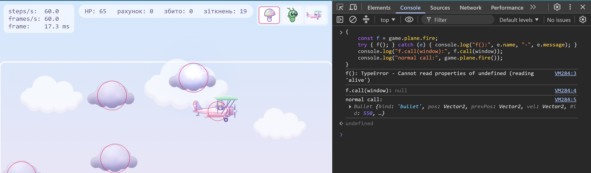
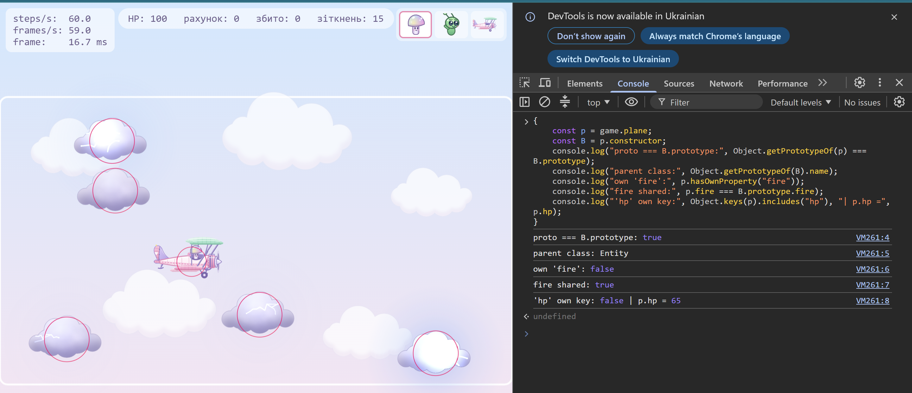

# Biplane Game

Лабораторна робота 2: «Об'єкти, прототипи та this: модель сутностей».

Браузерна гра: пастельний біплан, яким літаєш по арені на canvas.
- [lab-01](https://github.com/Sol777xxx/biplane-game/tree/lab-01): ігровий цикл, фіксований крок, експерименти з event loop.
- [lab-02](https://github.com/Sol777xxx/biplane-game/tree/lab-02): сутності, `World` на `Map`, колізії, кулі, композиція поведінок.

## Запуск

```
npm install
npm run dev
```

Потрібен Node.js 24 (див. `.nvmrc`). Гра: `http://localhost:5173/`.
Перевірка коду: `npx biome check .` · демонстрація `this`-бага: `node demo/this-bug.mjs`.

## Керування

| Клавіша | Дія |
|---|---|
| ← → ↑ ↓ або WASD | рух |
| Пробіл | стрільба |
| H | показати або сховати HUD |
| P | вимірювання (лаба 1): 5 с польоту вправо, результат у консолі |

Героя в кабіні обирають на панелі справа вгорі. Адреса з `?debug` відкриває `window.game` у консолі та показує хітбокси.

## Правила гри

- Хмарки дрейфують і відбиваються від країв; наліт на хмарку знімає 35 HP і знищує її.
- Кулі шкодять хмаркам (знищується за 2–3 влучання, очки = радіус) і кораблям. Біплан не виходить за арену, а куля за межею зникає.
- Знищений біплан вибухає й відроджується через 2 с у безпечній точці зі щитом на 2 с.
- Pickup'и (зірки): **S** щит, **R** швидкострільність, **H** самонавідні кулі. Частина хмарок наводиться на біплан (закоментоване пунктирне кільце для демонстрації).

## Архітектура

```
demo/
  this-bug.mjs   відтворення і фікс бага з this
src/
  loop.js      ігровий цикл (rAF + акумулятор)
  input.js     клавіатура як замикання
  main.js      збірка та HUD
  sim/         модель світу без DOM:
    vector.js    Vector2 (чисті методи)
    entity.js    базовий Entity, #id, behaviors, краї арени
    biplane.js   Biplane extends Entity, #hp, fire()
    objects.js   Bullet, Obstacle, Explosion, Pickup, createParticle
    behaviors.js homing, lifetime, drag, pickup (композиція)
    world.js     Map<id, Entity>, spawn/despawn/sweep, ofKind
    collision.js коло-коло, окрема система
    game.js      правила: рахунок, респаун, pickup'и
  render/      малювання на canvas
  ui/          панель вибору героя
```

Успадкування лише на один рівень: `Biplane`, `Bullet`, `Obstacle`, `Explosion`, `Pickup` розширюють `Entity`.
Частинки окремого класу не мають: це `Entity` з поведінками `lifetime` і `drag`.

## Баг з `this`

### У чому проблема

Метод `fire` лежить на `Biplane.prototype` і користується `this` (`this.pos`, `this.cooldown`, `this.world`).
Якщо передати його слухачу події *без об'єкта*, наприклад так:

```js
window.addEventListener("keydown", game.plane.fire); // баг
```

то передається лише функція, а не виклик. Слухач викликає її як `f()`, і `this` вже не біплан:

- слухач DOM викликає функцію з `this` = елемент, що отримав подію;
- `setTimeout(plane.fire, 100)` викликає з `this = window` (у Node це об'єкт `Timeout`);
- виклик `f()` без об'єкта у strict-режимі дає `this === undefined` (код класів завжди strict).

`this` визначається **в місці виклику**, а не там, де метод оголошено. Тому `this.alive` стає `undefined`,
`fire()` мовчки повертає `null`, пострілу немає, а помилки теж немає. Саме це робить баг підступним.

Правила `this` за пріоритетом: `new` → явне (`call` / `apply` / `bind`) → неявне (`obj.f()`) → за замовчуванням
(`undefined` у strict). Стрілочна функція власного `this` не має й бере його з оточення, як змінну із замикання.

### Як відтворити

```
node demo/this-bug.mjs
```

Очікуваний вивід:

```
1a. detached(): TypeError: Cannot read properties of undefined (reading 'alive')
1b. this = елемент: fire() повернув null, куль: 0
2. стрілка () => plane.fire(): нових куль 1
3. bind: plane.fire.bind(plane): нових куль 1
4a. метод без об'єкта: TypeError
4b. стрілка-поле: shots = 1
4c. метод спільний між екземплярами: true
4d. стрілка своя в кожного: true
```

- **1a**: функція відокремлена від об'єкта й викликана як `detached()`: `this === undefined`, помилка.
- **1b**: слухач події (`EventTarget`) викликає її з `this` = елемент: помилки немає, куль 0.
- **2, 3**: обидва фікси створюють нову кулю.
- **4a–4d**: порівняння методу класу та стрілки-поля (див. таблицю нижче).

Те саме в консолі браузера (`?debug`):

```js
{
	const f = game.plane.fire;
	try { f(); } catch (e) { console.log("f():", e.name, "-", e.message); }
	console.log("f.call(window):", f.call(window));
	console.log("normal call:", game.plane.fire());
}
```



- `f()`: відокремлена функція без об'єкта, `this === undefined`, `TypeError`.
- `f.call(window)`: `this` не біплан, `fire()` тихо повертає `null`, пострілу немає.
- `game.plane.fire()`: виклик через об'єкт, `this` біплан, повертається `Bullet`.

### Фікси та альтернативи

| Підхід | Плюс | Мінус |
|---|---|---|
| `() => plane.fire()` (обгортка-стрілка) | просто, `this` правильний | зайва функція; тримає змінну `plane`, а не об'єкт |
| `plane.fire.bind(plane)` | немає обгортки | нова функція; прив'язана до *конкретного* об'єкта: після респауну (новий `Biplane`) стріляла б знищеним літаком |
| `fire = () => {...}` полем класу | працює без обгортки, `this` завжди екземпляр | окрема функція в кожного екземпляра (пам'ять), метод не на прототипі, його не перевизначити через `super` |

### Що зроблено в грі

У грі слухач стрільби не передає метод напряму. Клавіатура зведена до знімка стану
(`input.snapshot()`, поле `fire`), а `Biplane.update` викликає `this.fire()` як `obj.method()`: неявне
прив'язування, `this` завжди біплан. Це також безпечно після респауну: `Game.step` щоразу бере
поточний `this.plane`. Сам баг відтворюється й виправляється в `demo/this-bug.mjs`.

## Експеримент з прототипами

Відкрити гру з `?debug` і ввести в консолі:

```js
{
	const p = game.plane;
	const B = p.constructor;
	console.log("proto === B.prototype:", Object.getPrototypeOf(p) === B.prototype);
	console.log("parent class:", Object.getPrototypeOf(B).name);
	console.log("own 'fire':", p.hasOwnProperty("fire"));
	console.log("fire shared:", p.fire === B.prototype.fire);
	console.log("'hp' own key:", Object.keys(p).includes("hp"), "| p.hp =", p.hp);
}
```



- `proto === B.prototype: true`: прототип екземпляра це `Biplane.prototype`.
- `parent class: Entity`: клас `Biplane` успадковує від `Entity` (один рівень).
- `own 'fire': false`, `fire shared: true`: метод не копіюється в об'єкт, він шукається по прототипу й спільний для всіх екземплярів.
- `'hp' own key: false`: `#hp` приватне поле, назовні доступний лише геттер `hp`.

## Дизайн: композиція замість ієрархії

**Вимога.** homing має працювати і на кулі, і на хмарці. Pickup стоїть, колізиться, але не корабель.

**Як виглядала б ієрархія.** Спроба через `extends`:
`Entity → Bullet → HomingBullet` і `Entity → Obstacle → HomingObstacle`. Алгоритм наведення
довелося б писати двічі. Якщо підняти його в спільного предка
(`Entity → Moving → Homing → Bullet / Obstacle`), то `Homing` наслідують *усі* кулі й хмарки,
навіть ті, що не мають наводитися. Нові властивості множать класи комбінаторно
(`HomingRapidBullet`, `HomingShieldObstacle`...). Pickup у цьому дереві став би або `Entity`
з порожнім `update`, або безглуздим нащадком `Moving`. Множинного наслідування в JS немає.

**Обраний підхід.** `Entity.behaviors`: масив маленьких об'єктів-поведінок
`{ name, attach?, update?, onCollide? }`. `Entity.update` і `Entity.onCollide` тільки викликають хуки.
Фабрики `homing()`, `lifetime()`, `drag()`, `pickup()` повертають такі об'єкти, а замикання зберігає
стан кожного екземпляра. Одна й та сама `homing` вішається і на кулю, і на хмарку:

```js
bullet.add(homing({ kinds: ["obstacle"], turnRate: 4 }));   // куля шукає хмарки
obstacle.add(homing({ kinds: ["biplane"], turnRate: 0.6 })); // хмарка шукає біплан
```

`Pickup`, `Explosion` і частинки отримують життєвий цикл із `lifetime`, а pickup-логіка
(ефект при дотику й зникнення) живе в поведінці `pickup(apply)`, а не в підкласі.

**Ціна.** Поведінки не типізовані, порядок `add` має значення, а підклас, що перевизначає `onCollide`,
мусить викликати `super`. Для гри цього розміру це дешевше за дерево класів.
Альтернативи: міксини через `Object.assign` (ризик колізій імен методів) і behavior-as-data
з великим `switch` (простіше серіалізувати, що знадобиться в Lab 5).

## Колізії та світ

- `World` зберігає сутності в `Map<id, Entity>` (числові ключі, `.size`, порядок вставки, немає успадкованих ключів).
- `despawn` лише позначає сутність мертвою, видалення робить `sweep` наприкінці кроку.
- `ofKind(kind)` генератор: віддає сутності одного виду без проміжного масиву.
- `findCollisions(world)` окрема система (наївний O(n²)), повертає пари, тож її можна замінити просторовим хешем.
- Події (`hit`, `crash`, `destroyed`, `pickup`) складаються у `world.events`, їх читає `Game`.