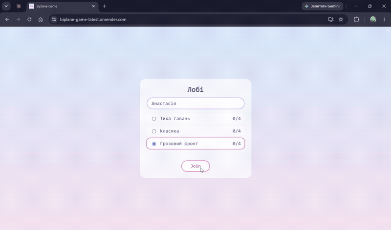
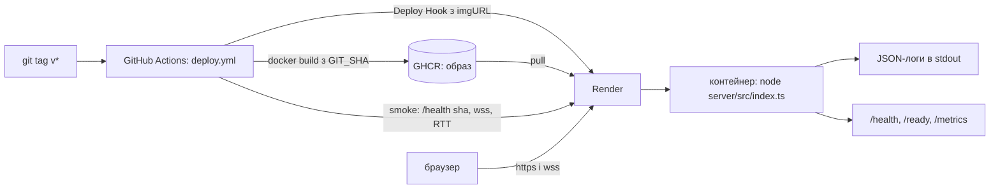

# Biplane Game

Лабораторна робота 8: «Публікуємо гру: Docker, метрики і жива адреса».

Браузерна гра: пастельний біплан, яким літаєш по арені на canvas.
- [lab-01](https://github.com/Sol777xxx/biplane-game/tree/lab-01): ігровий цикл, фіксований крок, експерименти з event loop.
- [lab-02](https://github.com/Sol777xxx/biplane-game/tree/lab-02): сутності, `World` на `Map`, колізії, кулі, композиція поведінок.
- [lab-03](https://github.com/Sol777xxx/biplane-game/tree/lab-03): пайплайн ассетів, екран завантаження, звук, шина подій, лобі.
- [lab-04](https://github.com/Sol777xxx/biplane-game/tree/lab-04): Node.js сервер, EventEmitter, streams, WebSocket-сервер.
- [lab-05](https://github.com/Sol777xxx/biplane-game/tree/lab-05): сервер рахує гру, передбачення й звірка, бінарний протокол.
- [lab-06](https://github.com/Sol777xxx/biplane-game/tree/lab-06): міграція на TypeScript, типи як договір, Zod на межах.
- [lab-07](https://github.com/Sol777xxx/biplane-game/tree/lab-07): тести (Vitest, fast-check, Playwright), CI, профілювання пам'яті й кадру, пул об'єктів, навантажувальний тест.

# Biplane Game

Браузерна гра для кількох гравців: пастельний біплан, яким літаєш по арені на canvas. Одну гру рахує сервер на Node.js, клієнт передбачає свій корабель і малює чужі з інтерполяцією.

[](https://github.com/Sol777xxx/biplane-game/actions/workflows/ci.yml)
[](https://github.com/Sol777xxx/biplane-game/actions/workflows/deploy.yml)

## Грати

**https://biplane-game-latest.onrender.com/** (WebSocket тільки через `wss://`)



Відео-огляд (3–5 хв): <!-- lab8:video -->[дивитись](https://youtu.be/nxRnG0LJt8M)<!-- /lab8:video -->

Сайт розгорнуто на безкоштовному тарифі Render: після 15 хвилин без трафіку сервіс засинає, і перше відкриття після цього триває близько хвилини ([документація Render](https://render.com/docs/free)). Сайт можна встановити як застосунок (PWA): у Chrome кнопка «Встановити» в адресному рядку.

### Як грати

1. Відкрийте сторінку, введіть ім'я й виберіть кімнату в лобі (або створіть свою).
2. Рух: стрілки або WASD. Стрільба: пробіл. Чат: Enter. `N` показує netgraph (RTT, вік знімка), `H` діагностику.
3. Збивайте хмарки кулями (очки = радіус), не врізайтеся в них і в чужі біплани, збирайте бонуси (S щит, R швидкострільність, H самонавідні кулі). Знищений біплан відроджується через 2 с.
4. Щоб зіграти вдвох, відкрийте ту саму кімнату з другого пристрою.

Керування лише з клавіатури: на телефоні гра відкривається, але грати там неможливо.


## Запуск

```
npm install
cp server/.env.example server/.env     # PowerShell: Copy-Item server/.env.example server/.env
npm run dev:server                     # термінал 1: сервер на :3000
npm run dev                            # термінал 2: клієнт (Vite) на :5173
```

## Керування

| Клавіша | Дія |
|---|---|
| ← → ↑ ↓ або WASD | рух |
| Пробіл | стрільба |
| H | показати або сховати діагностику (steps/s, frames/s); за замовчуванням схована |
| N | показати або сховати netgraph (RTT, вік знімка, байти/с, поправка…); за замовчуванням схований |
| Enter | відкрити чат; Enter надсилає, Esc повертає керування грі |

У netgraph: кнопка `prediction: on/off`, повзунок затримки інтерполяції і (з `ENABLE_NETSIM=1`) пресети мережі `0`, `100 ± 30`, `100 ± 30 + 2%`; активний пресет підсвічується.

Героя в кабіні обирають на панелі справа вгорі. Адреса з `?debug` відкриває `window.game` і `window.assets` у консолі та показує хітбокси.


## Правила гри

- Хмарки дрейфують і відбиваються від країв; наліт на хмарку знімає 35 HP і знищує її.
- Кулі шкодять хмаркам (знищується за 2–3 влучання, очки = радіус) і кораблям. Біплан, вилетівши за край арени, з'являється з протилежного боку, а куля за межею зникає.
- Над збитою хмаркою спливає «+N» (скільки очок додано).
- Знищений біплан вибухає й відроджується через 2 с у безпечній точці зі щитом на 2 с.
- Pickup'и (зірки): **S** щит, **R** швидкострільність, **H** самонавідні кулі. Частина хмарок наводиться на біплан.
- Параметри арени залежать від кімнати, обраної в лобі (див. розділ «Лобі»).


## Архітектура

```
client/
  index.html             сторінка з canvas і панелями, підключає src/main.ts
  vite.config.ts         конфіг Vite: збірка, dev-сервер, заглушки /api
  tsconfig.json          налаштування tsc для браузера (DOM, bundler)
  tsconfig.node.json     те саме для vite.config.ts (Node)
  public/                статика, яку Vite не обробляє
    assets/              manifest.json, sprites.json, arena.json, звуки .wav, broken.json (для ?chaos)
    api/rooms.json       список кімнат для режиму без сервера
  src/
    main.ts              точка входу: ассети, лобі, з'єднання, цикл; режими ?debug, ?hash, ?chaos
    loop.ts              ігровий цикл: окремо кроки й кадри, лічильники steps/s і frames/s
    input.ts             клавіатура → п'ять ключів вводу для сервера + службові дії H і N
    fx.ts                частинки та вибухи, підписані на шину подій
    hud.ts               спливаючі «+N» над збитою хмаркою
    loadingScreen.ts     екран завантаження, текст помилок
    lobby.ts             список кімнат і вибір кімнати
    netStats.ts          метрики для netgraph (без DOM і годинника)
    assets/
      loader.ts          fetch з retry і backoff, loadAll з прогресом, перевірка Zod
      audio/audio.ts     звуки; підписка на шину, sim про звук нічого не знає
    render/              уся канвас-графіка
      renderer.ts        малює кадр: switch за kind сутності, assertNever
      canvas.ts          тип Ctx і context2d() зі зрозумілою помилкою
      sprites.ts         спрайти з атласу, без нього процедурне малювання
      biplane.ts         біплан, крила й стійки (parts.ts)
      bullets.ts         кулі
      shield.ts          щит
      clouds.ts          фонові хмарки
      obstacles.ts       хмарки-перешкоди
      effects.ts         pickup'и й вибухи
      pilots/            герої в кабіні: mushroom, alien, empty
    net/                 мережа клієнта
      connection.ts      WebSocket: черга, reconnect з backoff, бінарні кадри
      roomSession.ts     join кімнати поверх connection, seq/ack, ping, netsim
      predictor.ts       передбачення свого корабля, звірка, згладжування
      interpolator.ts    буфер знімків, чужі сутності на now − delay
      snapshotView.ts    знімок → стан для малювання
      events.ts          події мережі (Zod) і типізована шина
      typedTarget.ts     EventTarget із типізованими подіями
    ui/                  DOM-панелі
      dom.ts             el() і query(): текст лише через textContent
      chatPanel.ts       чат (без innerHTML)
      lobbyView.ts       екран лобі
      netgraph.ts        панель мережі (RTT, вік знімка, байти/с, поправка)
      pilotPicker.ts     вибір героя
  test/                  node --test: клієнтська логіка без браузера
  tools/                 dogfight.mjs (боти), random-drift.mjs (дослід з Math.random), make-sounds.mjs (звуки)
shared/                  код, спільний для клієнта й сервера
  sim/                   симуляція (random.ts, hash.ts, snapshot.ts, scenario.ts, …)
  protocol/, codec/      типи повідомлень, binary.ts (специфікація в коментарі), json.ts
  tools/bench-codec.mjs  JSON проти binary
  test/                  чистота, детермінізм, кодеки, заміри
server/
  src/
    index.ts             точка входу: конфіг → сервер → graceful shutdown
    config.ts            PORT / HOST / LOG_DIR / MAX_ROOMS / ENABLE_* з оточення, з перевіркою
    app.ts               node:http, маршрути, життєвий цикл (listen / close)
    static.ts            роздача client/dist: MIME, захист від ..
    api.ts, body.ts, respond.ts, replayRoutes.ts   REST, читання тіла, відповіді
    rooms.ts             Room і RoomManager (EventEmitter)
    match.ts, matches.ts гра 30 Гц, черги input, знімки, ack
    netsim.ts, stats.ts  штучна мережа; лічильники тіків і input
    protocol.ts          формат повідомлень, валідація, коди закриття
    ws.ts                WebSocket: join, heartbeat, ліміти, повільні клієнти, кодеки
    limits.ts            token bucket
    log/matchlog.ts      події кімнати → Transform (NDJSON) → pipeline → файл
    log/replay.ts        читання NDJSON потоком
  tools/                 chat-client, flood, bigframe, lag-demo
  test/                  node --test
```

## Як це розгорнуто



- **Образ**: два етапи (збірка клієнта з Vite, потім чисте середовище з `npm ci --omit=dev`), користувач `node`, `HEALTHCHECK`, запуск `CMD ["node", "server/src/index.ts"]` без `npm start`. Розмір, непривілейований користувач, відсутність dev-залежностей і `docker stop` менше ніж за 10 с з кодом 0 перевіряє `scripts/verify-docker.mjs` у CI (задача `docker`).
- **Реліз**: тег `v*` запускає `.github/workflows/deploy.yml`: збірка образу, публікація в GHCR (теги `vX.Y.Z` і `latest`), виклик Deploy Hook Render, а потім `scripts/smoke.mjs` чекає, поки `/health` покаже SHA цього коміту, і перевіряє справжнє WebSocket-з'єднання.
- **Налаштування хостингу**: порт із `PORT`, `TRUST_PROXY=1`, `ALLOWED_ORIGINS=https://biplane-game-latest.onrender.com`, перевірка здоров'я за `/health`. Секрети (`RENDER_DEPLOY_HOOK`) лежать у GitHub Secrets, адреса (`APP_URL`) у змінній репозиторію; у коді й логах секретів немає.

### Служби й спостереження

| Адреса | Що віддає |
|---|---|
| `/health` | `{ status, sha, uptime, rss, heapUsed }`; `sha` дорівнює SHA тегу, що розгорнуто |
| `/ready` | 200, коли сервер приймає гравців; 503 під час зупинки або коли досягнуто `MAX_PLAYERS` |
| `/metrics` | текст Prometheus: гравці, кімнати, повідомлення/с і байти/с, час тіка, завантаження циклу подій, пам'ять, порушення протоколу, відхилені рукостискання (`biplane_*`) |

Логи це JSON (pino) у stdout, з полями `room` і `player` там, де вони відомі; паролів і токенів у них немає. Необроблений виняток і `unhandledRejection` пишуться як `fatal` і завершують процес із кодом 1.

## Збої й межі

Усе нижче перевіряється скриптом `node perf/chaos.mjs all` (сценарії `vanish`, `kill`, `flood`) і, на образі Docker, у GitHub Actions (workflow `Measure`). Повні таблиці: [docs/lab8.md](docs/lab8.md).

<!-- lab8:chaos -->
Запуск `linux-ci` (2026-11-22, Node v24.22.3):

| Сценарій | Перевірка | Результат | Деталі |
|---|---|---|---|
| vanish | у кімнаті 3 гравці | пройшло |  |
| vanish | сервер прибирає зниклого гравця з кімнати | пройшло | за 2 мс |
| vanish | решта гравців далі отримують знімки | пройшло | B +45 знімків |
| vanish | решта гравців дізналася про вихід (roster) | пройшло |  |
| vanish | сокети решти відкриті | пройшло |  |
| vanish | зниклий може повернутися під тим самим іменем | пройшло |  |
| kill | SIGTERM: сервер вийшов із кодом 0 | пройшло | код 0, 16 мс |
| kill | SIGTERM: вийшов швидше за 10 с | пройшло |  |
| kill | SIGTERM: усі 6 клієнтів отримали shutdown | пройшло | 6/6 |
| kill | SIGTERM: усі сокети закрито з кодом 1001 | пройшло | коди 1001, останній через 5 мс |
| kill | SIGTERM: логи скинуто, є запис «зупинено» | пройшло |  |
| kill | SIGTERM: усі рядки логу це JSON | пройшло | 22 рядків |
| kill | SIGKILL: усі клієнти помітили обрив | пройшло | 6/6 сокетів закрито, коди 1006 |
| kill | SIGKILL: нових з'єднань сервер не приймає (клієнт піде в лобі) | пройшло |  |
| flood | атакувальники шлють ≥ 600 кадрів/с | пройшло | 1458 кадрів/с з 3 з'єднань |
| flood | сервер закриває порушників кодом 4000-4009 | пройшло | 794/794, медіана життя 11 мс |
| flood | тік інших кімнат у межах бюджету 33,3 мс | пройшло | p99 0.35 мс (без атаки 0.462 мс) |
| flood | інші кімнати не пропускають тіки | пройшло | 0 проти 0 без атаки |
| flood | гравці в інших кімнатах не відключені | пройшло |  |
| flood | знімки в інших кімнатах не просіли | пройшло | 30/с проти 30/с |

Тік кімнат, які не атакують (32 гравці в 4 кімнатах), під потоком ≈ 1458 поганих кадрів/с із 3 з'єднань:

| | Тік p99, мс | Тік max, мс | Пропущено тіків | Цикл подій | Знімків/с на клієнта |
|---|---|---|---|---|---|
| без атаки | 0.462 | 1.34 | 0 | 5% | 30 |
| під атакою | 0.35 | 0.408 | 0 | 12% | 30 |
<!-- /lab8:chaos -->

Що з цього бачить гравець. **Клієнт зник посеред матчу**: сервер прибирає його з кімнати, решта отримує оновлений склад і гра йде далі. **Сервер зупинили чемно** (`docker stop`, нове розгортання): клієнти отримують `shutdown` і код `1001`, гра показує «Сервер перезапускається» й повертається в лобі. **Сервер убито раптово**: сокет рветься з кодом 1006, клієнт робить до 6 спроб перепідключення (затримка до 4 с), після чого теж повертається в лобі. **Потік поганих кадрів**: порушник закривається кодом 4000–4009 за кілька мілісекунд, а тік інших кімнат не росте.

## Скільки гравців витримує один процес

Навантажувальний тест (`perf/loadtest.mjs`): клієнти без браузера по 8 в кімнаті, `input` 30 разів за секунду від кожного. Рівень «тримає», якщо тік p99 ≤ 33,3 мс, пропущено ≤ 1% тіків і цикл подій менш ніж на 90% зайнятий. Образ запускається з обмеженням ЦП. Виміряно на Linux-машині GitHub Actions (`ubuntu-latest`), генератор навантаження на тій самій машині (`perf/measure-docker.mjs`).

<!-- lab8:capacity -->
| Обмеження контейнера | Ємність, гравців | Де перестав триматися | Причина |
|---|---|---|---|
| docker-cpu1 | **512** | 1024 | пропущено 5609 тіків з 143567 |
| docker-render-free | **32** | 64 | пропущено 132 тіків з 4613 |

Повні таблиці рівнів і графіки: [loadtest-docker-cpu1](docs/perf/loadtest-docker-cpu1.md), [loadtest-docker-render-free](docs/perf/loadtest-docker-render-free.md).
<!-- /lab8:capacity -->

Режим `docker-render-free` має ті самі обмеження, що безкоштовний інстанс Render: 0,1 ядра й 512 МБ ([Render: compute plans](https://render.com/docs/compute-plans.md)). Тому для живого сайту реальна місткість близько **тридцяти двох гравців** (4 кімнати по 8); понад це сервер починає пропускати тіки.

## RTT з двох мереж

Двоє гравців з різних мереж грали одночасно на живому сайті. RTT міряє `scripts/rtt.mjs` (20 пінгів по справжньому `wss://`).

<!-- lab8:rtt -->
| Хто й звідки | Підключення, мс | RTT min | p50 | p95 | max | Зразків |
|---|---|---|---|---|---|---|
| Анастасія, мобільний інтернет Київстар | 289 | 58 | 63 | 76 | 76 | 20 |
| Анастасія, домашній Wi-Fi, провайдер | 159 | 41 | 42 | 51 | 51 | 20 |
<!-- /lab8:rtt -->

## Підсумкові таблиці попередніх лаб

**Лаба 5: бінарний протокол і мережа** (`npm test`, виводить `client/test/binary.test.mjs` і `client/test/dogfight.test.mjs`):

| Показник | JSON | Бінарний |
|---|---|---|
| Середній розмір знімка, байт (кімната з одним гравцем) | 626 | 179 |

| Два боти, 100 ± 30 мс, 2% втрат, 6 с | Без інтерполяції | З інтерполяцією 100 мс |
|---|---|---|
| Частка часу, коли чужий корабель стоїть | 42,6% | 0,2% |

**Лаба 7: ємність процесу на ноутбуці без Docker** (i7-12700H, Windows, генератор на тій самій машині; деталі й профілі в розділі «Лаба 7» нижче):

| Клієнтів | Цикл подій після, % | Тік p99 після, мс | Тримає |
|---|---|---|---|
| 8 | 6 | 2,3 | так |
| 64 | 21 | 1,6 | так |
| 256 | 77 | 4,5 | так |
| 512 | 100 | 1,4 | **ні** |

Ємність на ноутбуці 256, у контейнері на Linux із повним ядром 512: різні машини й ОС, тому числа не порівнюються напряму.

## Що ще не доведено

- **Керування лише з клавіатури.** Телефон без клавіатури гру не потягне.
- **Безкоштовний Render.** Сервіс засинає після 15 хвилин, перший гравець чекає близько хвилини, а при 0,1 ядра місткість ≈ 32 гравці. Диск тимчасовий: журнали матчів (`LOG_DIR`) зникають при перезапуску.
- **Один процес.** Стан кімнат живе в пам'яті: після перезапуску кімнати порожні, горизонтально сервіс не масштабується.
- **`X-Forwarded-For` довіряється** (`TRUST_PROXY=1`): за проксі Render це перше значення, але його можна підробити, тож ліміт з'єднань на IP не є захистом від цілеспрямованого обходу.
- **`/metrics` відкритий без пароля**: там немає секретів, але видно навантаження сервера. На справжньому проєкті його закрили б.
- **Навантаження міряли на одній машині з генератором**, а місткість живого сайту, ймовірно, нижча за виміряну через сусідів на спільному хості Render.
- **PWA кешує лише оболонку** (HTML, стилі, скрипти): без мережі гра не працює, бо потрібен сервер.

## Лаби 1–6: запуск, протокол, захист

## Запуск

```
npm install
cp server/.env.example server/.env     # PowerShell: Copy-Item server/.env.example server/.env
npm run dev:server                     # термінал 1: сервер на :3000
npm run dev                            # термінал 2: клієнт (Vite) на :5173
```

Потрібен Node.js 24 (див. `.nvmrc`). Перевірка коду: `npx biome check .` · типи: `npm run typecheck` · тести: `npm test` (усі три пакети: `client`, `server`, `shared`).

### Штучна мережа

Щоб перевіряти гру при затримці й втратах, додайте в `server/.env` рядок `ENABLE_NETSIM=1` і перезапустіть сервер. Тоді працюють параметри адреси та кнопки в netgraph:

| Параметр | Що робить |
|---|---|
| `?lag=100&jitter=30&loss=2` | штучна мережа на сервері: RTT, розкид, % втрат знімків і input |
| `?interp=100` | затримка інтерполяції чужих сутностей, мс (0–500, за замовчуванням 100) |
| `?smooth=100` | згладжування поправки звірки, мс (0 вимикає, за замовчуванням 100) |
| `?codec=json` | JSON замість бінарного протоколу, для порівняння |
| `?hash` | у консолі хеш симуляції (1000 кроків, seed 1) і хеші перших 20 кроків; `&dump=N` ще й стан сутностей після кроку N |

Без `ENABLE_NETSIM=1` сервер ігнорує `lag`, `jitter` і `loss`, а кнопки пресетів не з'являються.

## Керування

| Клавіша | Дія |
|---|---|
| ← → ↑ ↓ або WASD | рух |
| Пробіл | стрільба |
| H | показати або сховати діагностику (steps/s, frames/s); за замовчуванням схована |
| N | показати або сховати netgraph (RTT, вік знімка, байти/с, поправка…); за замовчуванням схований |
| Enter | відкрити чат; Enter надсилає, Esc повертає керування грі |

У netgraph: кнопка `prediction: on/off`, повзунок затримки інтерполяції і (з `ENABLE_NETSIM=1`) пресети мережі `0`, `100 ± 30`, `100 ± 30 + 2%`; активний пресет підсвічується.

Героя в кабіні обирають на панелі справа вгорі. Адреса з `?debug` відкриває `window.game` і `window.assets` у консолі та показує хітбокси.


## Правила гри

- Хмарки дрейфують і відбиваються від країв; наліт на хмарку знімає 35 HP і знищує її.
- Кулі шкодять хмаркам (знищується за 2–3 влучання, очки = радіус) і кораблям. Біплан, вилетівши за край арени, з'являється з протилежного боку, а куля за межею зникає.
- Над збитою хмаркою спливає «+N» (скільки очок додано).
- Знищений біплан вибухає й відроджується через 2 с у безпечній точці зі щитом на 2 с.
- Pickup'и (зірки): **S** щит, **R** швидкострільність, **H** самонавідні кулі. Частина хмарок наводиться на біплан.
- Параметри арени залежать від кімнати, обраної в лобі (див. розділ «Лобі»).

## Конфігурація

Читається з оточення (`node --env-file=.env`), перевіряється при старті; усі помилки виводяться разом, процес завершується з кодом 1.

| Змінна | За замовчуванням | Значення |
|---|---|---|
| `PORT` | `3000` | ціле 0–65535 |
| `HOST` | `127.0.0.1` | адреса прослуховування |
| `LOG_DIR` | `./logs` | куди писати журнали матчів |
| `MAX_ROOMS` | `50` | ліміт кімнат на сервері (ціле ≥ 1) |
| `ENABLE_SLOW` | вимкнено | `1` вмикає `/api/slow` (демонстрація блокування, лише для експериментів) |
| `ENABLE_NETSIM` | вимкнено | `1` вмикає штучну затримку й втрати (`?lag`, `?jitter`, `?loss`, повідомлення `netsim`), лише для розробки |
| `CLIENT_DIR` | `client/dist` | що роздавати як статику |
| `ALLOWED_ORIGINS` | порожньо | дозволені `Origin` рукостискання WebSocket через кому (`https://хост`, без слеша наприкінці). Порожньо: `Origin` мусить збігатися з `Host` |
| `MAX_CONN_PER_IP` | `20` | одночасних з'єднань з однієї адреси (`429` на рукостисканні) |
| `MAX_PLAYERS` | `200` | гравців у всіх кімнатах разом; понад ліміт `join` закривається кодом `4006`, а `/ready` віддає 503 |
| `TRUST_PROXY` | вимкнено | `1`: адреса клієнта береться з першого значення `X-Forwarded-For` (лише за проксі хостингу, інакше її можна підробити) |
| `LOG_LEVEL` | `info` | `fatal`…`trace`, `silent` |
| `GIT_SHA` | `dev` | SHA збірки; образ отримує його від CI, його показує `/health` |

## HTTP API

| Запит | Відповідь |
|---|---|
| `GET /health` | `{ status, uptime, rss, heapUsed }` |
| `GET /api/rooms` | список кімнат |
| `POST /api/rooms` | створює кімнату: `{ name, max?, preset? }`, `201` + `Location`; `503`, якщо досягнуто `MAX_ROOMS` |
| `GET /api/stats` | лічильники матчів: тіки, пропущені тіки (`skipped`), довгі тіки (`overruns`), час тіку, `inputs.repeated` і `inputs.dropped` |
| `GET /api/replays` | список журналів матчів |
| `GET /api/replays/:id` | файл журналу потоком (`application/x-ndjson`) |
| `GET /api/slow?ms=300&mode=block\|sleep` | лише з `ENABLE_SLOW=1`, інакше `404` |

Помилки це JSON з тим самим статусом: `400` (погане тіло/параметри), `404`, `405` (з `Allow`), `413` (тіло > 1 КБ), `415` (не JSON).
Статика: шлях із `..` дає `403`, зламане `%`-кодування `400`; перевірка йде за сирим `req.url`, бо `URL` сам «нормалізує» `/../`.

## Протокол WebSocket

Текстові повідомлення це JSON з `v: 1` і `type`. Набір полів **строгий**: зайве чи відсутнє поле це порушення протоколу. Бінарними можуть бути лише `input` (клієнт → сервер) і `snapshot` (сервер → клієнт).

| Напрямок | `type` | Поля |
|---|---|---|
| клієнт → сервер | `join` | `room` (`[\w-]{1,32}`), `name` (1–16 символів) |
| клієнт → сервер | `chat` | `text` (1–200 символів) |
| клієнт → сервер | `input` | `seq`, `up`, `down`, `left`, `right`, `fire`; JSON або бінарний (7 байт) |
| клієнт → сервер | `ping` | `t` |
| клієнт → сервер | `netsim` | `lag`, `jitter`, `loss` (з `ENABLE_NETSIM=1`, інакше сервер відповідає `enabled: false`) |
| клієнт → сервер | `leave` | немає |
| сервер → клієнт | `joined` | `you`, `room`, `players` |
| сервер → клієнт | `roster` | `players` |
| сервер → клієнт | `snapshot` | `tick`, `ack`, кораблі, хмарки, кулі, бонуси, події; бінарний за замовчуванням, JSON з `?codec=json` |
| сервер → клієнт | `pong` | `t` |
| сервер → клієнт | `netsim` | `enabled`, `lag`, `jitter`, `loss` |
| сервер → клієнт | `chat` | `name`, `text` |
| сервер → клієнт | `shutdown` | `reason`: сервер зупиняється, далі сокет закривається кодом 1001 |
| сервер → клієнт | `error` | `code`, `message` (після нього сокет закривається) |

Клієнт шле лише п'ять булевих клавіш і `seq`; позиції чи швидкості в протоколі немає. Сервер у кожному знімку повертає `ack`: `seq` останнього input цього гравця, який він обробив.

Перше повідомлення мусить бути `join` і прийти за 5 с. Порушення закриває сокет із кодом:

| Код | Причина | Клієнт перепідключається? |
|---|---|---|
| 1000 | нормальне закриття (`leave`) | ні |
| 1001 | сервер зупиняється | так |
| 1003 | бінарний кадр з чужою версією (перший байт не 1) | ні |
| 1009 | кадр більший за `maxPayload` (2048 Б) | ні |
| 1011 | внутрішня помилка | так |
| 4000 | не JSON, чужа версія, зайве чи погане поле, зламана розкладка бінарного input | ні |
| 4001 | невідомий `type` | ні |
| 4002 | `join` не прийшов за 5 с | ні |
| 4003 | повідомлення до `join` | ні |
| 4004 | повторний `join` | ні |
| 4005 | кімнати немає | ні |
| 4006 | кімната заповнена | ні |
| 4007 | ім'я зайняте | так, після першого успішного join (сервер ще міг не прибрати мертвий сокет) |
| 4008 | перевищено ліміт повідомлень | ні |
| 4009 | клієнт надто повільний | ні |

### Бінарний формат

Little-endian скрізь, кадр починається з байтів «версія, тип». Повна специфікація в коментарі на початку `shared/codec/binary.ts`. Розміри: заголовок знімка 17 байт, гравець 11 + довжина id, корабель 33, хмарка 22, бонус 14, куля 27, подія до 10. Input рівно 7 байт. Кут `pitch` це `Int16` у десятитисячних частках радіана. Id сутностей це `u32`, а не `u16`: лічильник id росте всю гру, і `u16` переповнився б після 65 536 куль. Декодер строгий: обрізаний кадр, зайві байти чи чужа версія дають `CodecError`, а не тихе сміття.

### Життя з'єднання

- **Heartbeat**: сервер шле `ping` раз на 15 с; два пропущені `pong` поспіль і сокет рветься (`terminate`). Без цього «мертві» з'єднання (клієнт зник без `close`) жили б вічно і тримали місце в кімнаті.
- **Клієнт** (`connection.ts`): повідомлення, надіслані до відкриття, стоять у черзі; після `open` спершу йде `join`, потім решта. Reconnect з exponential backoff і jitter. Закриття, ініційоване користувачем, повторів не викликає. Бінарний input у закритому з'єднанні не стає в чергу (старий input був би марним).
- **Graceful shutdown**: `SIGINT` / `SIGTERM` → `/ready` стає 503, нові з'єднання не приймаються (503 на рукостисканні), клієнти отримують `shutdown` і закриття `1001`, потім кімнати, матчі, журнали; запас на все це 8 с, інакше `exit 1`. Код виходу 0. Клієнт після `shutdown` не перепідключається нескінченно: показує повідомлення й повертається в лобі.

## Кімнати: `EventEmitter`

`Room extends EventEmitter` не знає про сокети; кожен сокет підписується на події сам і відписується при закритті.

| Подія | Коли |
|---|---|
| `join`, `leave`, `chat` | гравець зайшов, вийшов, написав |
| `input` | прийшов input гравця (його слухає `Match`) |
| `matchstart` | зайшов перший гравець у порожню кімнату |
| `empty` | вийшов останній (`RoomManager` видаляє непостійну кімнату) |
| `event` | кожна з подій вище в єдиному форматі `{ t, type, … }`, джерело для журналу |

`RoomManager extends EventEmitter` кидає `created`. Кімната, куди ніхто не зайшов, видаляється через 60 с, інакше `POST /api/rooms` створював би їх назавжди.
Кімнати не емітують `"error"`: помилки валідації це виключення з `RoomError`, а не подія без слухача.

## Журнал матчу і повтор: потоки

```
room "event" → NdjsonTransform (objectMode) → createWriteStream(<LOG_DIR>/<room>-<час>.ndjson)
```

`pipeline` з'єднує ланки й передає помилку з будь-якої на всі. Матч це період, коли в кімнаті є хоча б один гравець: `match_start` … `match_end`, по рядку JSON на подію.
`GET /api/replays/:id` віддає файл через `pipeline(createReadStream, res)`, а `replay.ts` читає його як асинхронний генератор (`readEvents`), складаючи шматки в рядки. Id перевіряється регулярним виразом `^[\w-]{1,128}$` за сирим шляхом, тож вийти з `LOG_DIR` неможливо.

## Захист від зловживань

| Загроза | Захист |
|---|---|
| сплеск повідомлень | три token bucket на з'єднання: усі кадри 90 + 60/с, керування (`join`, `chat`, `ping`, `netsim`) 10 + 5/с, `input` 60 + 40/с; перевищення це `4008` |
| величезний кадр | `maxPayload` 2048 Б: `ws` відкидає кадр до того, як зібрати його в пам'ять (`1009`) |
| сміття замість JSON чи бінарного кадру | строга валідація, ключі типу `__proto__` / `toString` відхиляються через `Object.hasOwn`; чужа версія бінарного кадру `1003`, зламана розкладка `4000` |
| підроблені дані гравця | у протоколі немає позицій чи швидкостей: клієнт шле лише клавіші й `seq`; перезарядка й швидкість живуть на сервері |
| забагато кімнат | `MAX_ROOMS` (`503` на `POST`) |
| забагато гравців | `max` кімнати (1–8), `4006` |
| «німий» клієнт | таймер `join` 5 с, heartbeat |
| повільний клієнт | політика за `ws.bufferedAmount`, див. нижче |
| штучна мережа в проді | `ENABLE_NETSIM` вимкнено за замовчуванням, параметри `lag/jitter/loss` ігноруються |
| важка відповідь у пам'ять | журнали віддаються потоком, тіло запиту обмежене 1 КБ |

**Повільний клієнт.** Якщо клієнт не читає, байти копляться в буфері сокета, а при розсилці на N клієнтів це N копій. Є два пороги: вище 16 КБ сервер перестає слати цьому клієнтові `chat` (потік, втрата одного повідомлення не ламає стан); вище 256 КБ з'єднання закривається кодом `4009`. `roster` не відкидається, бо це стан, а не потік. Якщо клієнт не прочитає навіть `close`-кадр, через 1 с сокет рветься примусово.

---

## Як це влаштовано (лаба 5)

У грі одну гру рахує сервер: клієнт шле `input` (п'ять клавіш і `seq`), сервер 30 разів на секунду рахує світ і розсилає знімки. Щоб гра не «гальмувала» при затримці, клієнт передбачає свій корабель, а чужі малює з інтерполяцією.

| Частина | Що робить |
|---|---|
| `shared/sim` | та сама симуляція в браузері й Node: фіксований крок, генератор `mulberry32` із seed від сервера, без `Math.random`, `Date.now` і DOM |
| `shared/protocol`, `shared/codec` | типи повідомлень, JSON-кодек і бінарний кодек на `DataView` |
| `server/src/match.ts` | 30 Гц за абсолютним цільовим часом (`setTimeout`, не `setInterval`), черги input, `ack`, знімки |
| `server/src/netsim.ts` | затримка, розкид і втрати на шляху повідомлень |
| `client/src/net/predictor.ts` | передбачення свого корабля й куль, звірка з повтором input, згладжування поправки |
| `client/src/net/interpolator.ts` | буфер знімків, чужі сутності малюються на `now − delay` |
| `client/src/ui/netgraph.ts` | RTT, вік знімка, байти/с, input без `ack`, поправка |

Потік даних: клавіші → `input {seq}` → сервер бере по одному input за тік і рахує світ → знімок із `tick` і `ack` → клієнт скидає свій корабель у стан сервера, відкидає input з `seq ≤ ack` і заново програє решту.

---

# Лаба 7: V8, пам'ять і тести

Усі виміри зроблено на ноутбуці з i7-12700H, Node 24.13, Chrome 159, Windows. Скрипти лежать у `perf/`, сирі результати в `docs/perf/`. Клієнтські записи йдуть із **уповільненням CPU ×4** (`--throttle 4`): на цьому процесорі без нього кадр і так коротший за 4 мс, і різниці між версіями не видно.

## Що де лежить

| Вимога | Де |
|---|---|
| Vitest у трьох пакетах, `npm test` | `vitest.config.ts` (projects), тести в `client/test`, `server/test`, `shared/test` |
| fast-check, ≥ 5 властивостей | `shared/test/properties.test.mjs` (9) |
| покриття `shared/` ≥ 85% | `npm run coverage`: поріг у `vitest.config.ts`, нижче нього команда падає |
| Playwright, два браузери | `e2e/game.spec.ts`, `playwright.config.ts` |
| CI на кожен push | `.github/workflows/ci.yml` |
| профілювання клієнта | `perf/session.mjs`, `perf/analyze.mjs`, `perf/cdp.mjs`, `client/src/perf.ts` |
| боти | `server/src/bots.ts`, `POST /api/rooms/:id/bots` |
| навантажувальний тест | `perf/loadtest.mjs`, `perf/loadreport.mjs` |
| Worker, V8, fast-check «Prove it» | `perf/experiments/` |

## Тести (M1)

Понад 500 тестів: вектор, `integrate`, колізії, детермінізм кроку (еталонний хеш 1000 кроків `d68b1ebf`), звірка клієнта із сервером, ліміт частоти, ігровий цикл на фейкових таймерах (`client/test/loop.test.mjs`), кодеки, пул об'єктів.

Властивості fast-check (`shared/test/properties.test.mjs`):

1. `input`: `decode(encode(seq, keys))` дає те саме повідомлення.
2. Знімок: після декодування те саме повідомлення, кут з точністю до кроку квантування.
3. Довжина кадру збігається з описом формату.
4. Випадкові байти: повідомлення або `CodecError`, ніколи інший виняток.
5. Зіпсований справжній кадр (обрізаний, зайвий байт, змінений заголовок) дає `CodecError`.
6. Після 1000 випадкових кроків кожен корабель усередині арени.
7. `parseClientMessage` приймає кожне правильне повідомлення.
8. `parseClientMessage` відхиляє кожну мутацію: зайве поле, пропущене поле, чужу версію, невідомий тип.
9. Не-об'єкт на вході (`null`, число, рядок, масив) це відмова, а не виняток.

## e2e і CI (M2)

`e2e/game.spec.ts` піднімає сервер зі збіркою клієнта й відкриває два браузери в одній кімнаті. Три сценарії: обидва бачать однаковий склад гравців; рух Alice видно в Bob за 500 мс; повідомлення чату доходить. CI (`ci.yml`): `npm ci` → Biome → `tsc` → покриття → збірка → Playwright; звіт Playwright вантажиться, якщо e2e впав. Правило `noFloatingPromises` (Biome, nursery) увімкнено як помилку: воно знайшло 11 місць, де проміс губився (`lobby.ts`, `matchlog.ts` і дев'ять у `properties.test.mjs`).

## Профілювання клієнта (M3)

**Методика.** `npm run perf -- --label <ім'я> --throttle 4`: сервер, кімната з 8 ботами-«розкидачами», 3 с розігріву, 30 с запису. Перша фаза: метрики кадра (`performance.now` навколо update і render, `client/src/perf.ts`) і паузи GC з трасування V8. Друга: CPU-профіль і семплінговий профіль купи (`HeapProfiler`, джерело те саме, що в DevTools «Allocation sampling»). Збірка без мініфікації, щоб імена функцій читалися.

| | до | після рендера | після світу | після пулу |
|---|---|---|---|---|
| Кадр p50 / p95 / p99, мс | 7,1 / 22,9 / 31,7 | 5,9 / 10,9 / 19,8 | 4,9 / 8,7 / 17,1 | 5,3 / 8,2 / 11,4 |
| Кадрів довших за 16,7 мс | 37 з 375 | 6 з 422 | 5 з 497 | 1 з 491 |
| Minor GC, шт. / разом, мс | 22 / 44,7 | 13 / 25,7 | 9 / 19,9 | 12 / 22,2 |
| Major GC, шт. / разом, мс | 2 / 20,4 | 2 / 14,4 | 2 / 16,5 | 2 / 15,9 |
| Виділено за 30 с, МБ | 151,7 | 69,0 | 51,2 | ≈ 55 |
| Найбільший алокатор | `addCurve` 19% | `next` 17% | `drawObstacle` 8% | `update` 11% |

Без throttle: p99 кадра 2,8 мс (до, перший запис, мініфікована збірка) і 3,6 мс (після); виділено 490 МБ → 82 МБ (−83%), major GC 13 → 9.

**Що змінено, у порядку виміру**

1. **Рендер щита й частинок** (`render/shield.ts`, `render/effects.ts`). Топ-3 «до» (`addCurve`, `drawShield`, `spherePoint`) давали 47% усіх алокацій: кожен кадр створював масиви точок, градієнт і рядки `rgba()`. Тепер буфери `Float64Array` виділено один раз, градієнт кешований, прозорість через `globalAlpha`. Алокації 151,7 → 69,0 МБ, p99 31,7 → 19,8 мс.
2. **Світ без копій і генераторів** (`shared/sim/world.ts`, `client/src/fx.ts`, `net/snapshotView.ts`). `ofKind` віддавав новий генератор, `step` копіював масив, `view()` збирав новий масив на сутність. Тепер це живі масиви за видом і буфери, що перевикористовуються. Хеш симуляції не змінився. 69,0 → 51,2 МБ.
3. **Пул куль і частинок, без нових векторів** (`Bullet.obtain`, `Particle.obtain`, `World.sweep` → `recycle()`). Постріл і `homing` рахують на місці, без `Vector2` на кожен кадр. Тести: стан після повторного використання чистий, `homing` дає ті самі числа, що `Vector2.fromAngle`, хеш той самий. У мікротесті без GC: 500 вибухів по 26 частинок дають 15,0 → 2,3 МБ, симуляція 8 гравців 513 → 293 Б на крок. **У профілі браузера різниці майже немає** (≈ 53 → 55 МБ, GC той самий): у сцені з ботами влучань мало, а більшість алокацій тепер у малюванні (`drawObstacle`, `draw`), а не в симуляції. Пул лишено, бо він коректний і перевірений, але чесна оцінка така: на цьому сценарії він вимірного виграшу не дав.

**p99 і major GC.** Ціль p99 < 16,7 мс виконана: 11,4 мс при ×4 (без throttle 3,6). Один запис (30 с, ~500 кадрів) дає p99 по 5 найгірших кадрах, тому розкид між прогонами одного коду великий: код «після світу» дав p99 12,0, 17,1 і 10,0 мс. Тож дивитись треба на кілька прогонів, а не на один.

**«Нуль major GC» не виконано, є точне пояснення.** Лишилось 2 major за 30 с, по 8–10 мс при ×4 (≈ 2–3 мс на реальному CPU, менше за бюджет кадра). Причина в обох випадках одна: `finalize incremental marking via stack guard`. Купа до збірки 9–12 МБ, після неї щоразу рівно 4,5 МБ. Значить, витоку немає: V8 просто прибирає об'єкти, що пережили два scavenge і потрапили в старе покоління (знімки, вектори корабля), а поріг для першого major на малій купі низький. Інший прогін без throttle показав ще й одну паузу 24 мс на 1,9 с: це розгін JIT на старті сторінки, а не гра.

## Сервер: профіль і колізії

Профіль сервера за 60 с під 128 клієнтами (`node --cpu-prof`, `perf/topcpu.mjs`), активним був лише 14% часу:

| Функція | Власний час, мс | % активного часу |
|---|---|---|
| `writev` (запис у сокет) | 6032 | 41,5% |
| `#step` (`match.ts`) | 334 | 2,3% |
| `withAck` | 310 | 2,1% |
| `findCollisions` | 217 | 1,5% |
| `encodeSnapshot` | 213 | 1,5% |
| `encode` (TextEncoder) | 174 | 1,2% |
| `step` (`world.ts`) | 174 | 1,2% |

- **Просторовий хеш не потрібен.** Колізії «всіх з усіма» це 1,5% активного часу, уся симуляція разом близько 6%. Лаба велить міняти їх лише коли вони з'їдають час кроку: тут це не так, тож рішення «no-go».
- **Що знайшов профіль «до».** Знімок кімнати однаковий для всіх, але кодувався заново на кожен сокет (`encodeSnapshot`, `encode`, `clampInt`, `Writer` разом ≈ 1350 мс). Тепер кадр кодується раз за тік, а кожному сокету віддається копія зі своїм `ack` (`withAck`). Витрати на кодування впали вдвічі (≈ 700 мс), і тест перевіряє, що байти ті самі, що й при кодуванні напряму.
- **Але ємність це не змінило**, бо ліміт інший (див. нижче): запис у сокет.

## Боти і навантаження (M4)

**Боти.** `POST /api/rooms/:id/bots` з тілом `{ "count": 1..16, "spray": true }` додає ботів, `DELETE` прибирає. Бот (`server/src/bots.ts`, функція `decide`) це гравець без сокета: слухає знімки кімнати й відповідає тією самою подією `input` (п'ять клавіш і зростаючий `seq`), що й клієнт, тож сервер не відрізняє його від людини.

**Worker: NO-GO** (`perf/experiments/worker.mjs`, вимір на `worker_threads`; клонування й transfer працюють так само, як у браузерному Worker). Знімок із 8 кораблів і 20 куль це 947 Б.

| | p50, мкс | середнє, мкс |
|---|---|---|
| `decodeSnapshot` на головному потоці | 6,9 | 9,1 |
| лише отримання готового результату з Worker (структуроване клонування) | 32,4 | 33,6 |
| повний круг main → worker → main | 68,8 | 75,1 |

Декодування коштує 9 мкс, а лише прийняти результат з Worker 34 мкс: головний потік **програє** 24,5 мкс на знімок (≈ 0,7 мс/с) і ще отримує додаткову затримку. Для великих буферів картина інша (50 МБ): клонування блокує відправника на 16,4 мс (разом 29,6 мс), transfer 0,03 мс (разом 0,4 мс), після transfer буфер у відправника detached. Worker мав би сенс для важкої роботи на знімок (багато мс) або великих буферів через transfer. Наші знімки малі, тож Worker лишається поза проєктом.

**Навантажувальний тест** (`npm run loadtest -- --label after --levels 8,32,64,128,256,512,1024`). Клієнти без браузера: 8 на кімнату, бінарний кодек, генератор розкладено на 4 потоки (`worker_threads`), щоб він сам не став вузьким місцем. Рівень «тримає», якщо тік p99 ≤ 33,3 мс, пропущено ≤ 1% тіків, цикл подій < 90% і генератор не відстає більше ніж на 20 мс.

| Клієнтів | Цикл подій до, % | Цикл подій після, % | Тік p99 до / після, мс | Тримає |
|---|---|---|---|---|
| 8 | 6 | 6 | 2,0 / 2,3 | так |
| 32 | 12 | 13 | 5,2 / 6,4 | так |
| 64 | 20 | 21 | 1,7 / 1,6 | так |
| 128 | 35 | 37 | 1,7 / 1,6 | так |
| 256 | 63 | 77 | 7,1 / 4,5 | так |
| 512 | 96 | 100 | 1,2 / 1,4 | **ні** |
| 1024 | 73 | 51 | 2,8 / 1,3 | ні (запустилось 42–47 кімнат зі 128) |

**Ємність N = 256 клієнтів** (32 кімнати по 8), і до, і після оптимізації. На 512 цикл подій заповнений (96–100%), пропущено 91–1476 тіків. На 1024 сервер деградує: клієнти не отримують 30 знімків/с, тому відсоток тут не показник.

Крок симуляції за ємності не обмежує: тік p99 ≤ 7 мс при бюджеті 33,3. Тому критерій «тік > 33 мс» тут не спрацьовує, і ємність знаходимо за завантаженням циклу подій. Усі виміри з генератором на тій самій машині; на Linux системний виклик запису дешевший, і ємність, імовірно, була б більшою (не перевірялось). Запізнення p99 ≈ 16 мс навіть на 8 клієнтах: гранулярність таймера Windows (≈ 15,6 мс), це гіпотеза.

## «Prove it»

1. **V8: оптимізація й деоптимізація** (`node --allow-natives-syntax perf/experiments/optimize.mjs`, додайте `--trace-opt --trace-deopt`, щоб побачити рядки V8 про причину деопту).

```text
щойно створена                     status=129    IsFunction, Interpreted
після двох викликів із числами     status=129    IsFunction, Interpreted
після %OptimizeFunctionOnNextCall  status=81     IsFunction, Optimized, TurboFanned
після виклику зі рядками           status=129    IsFunction, Interpreted
знову з числами                    status=129    IsFunction, Interpreted
add("a", "b") = "ab"
```

   Статус це набір бітів: `129 = 1 + 128` (функція, інтерпретується), `81 = 1 + 16 + 64` (функція, оптимізована, TurboFan). Після `%OptimizeFunctionOnNextCall` і одного виклику `add` отримує машинний код, розрахований на числа. Виклик зі рядками порушує це припущення, і V8 викидає оптимізований код: статус знову 129. Повторний виклик із числами оптимізацію автоматично не повертає, функція має знову накопичити зворотний зв'язок.

2. **Мільйон об'єктів** (той самий скрипт, медіана з 9 запусків, мс; сума `x`) і окремо з `v8.mjs`:

| Сума `x` по 1 000 000 елементів (медіана з 9), мс | |
|---|---|
| звичайні об'єкти `{x, y}` | 2,56 |
| ті самі, але кожен десятий має ще й `z` (дві форми) | 2,82 |
| `Float32Array` | 0,73 |

   Дві форми коштують ≈ 10% (поліморфний inline cache на двох формах ще дешевий; мегаморфний був би значно гіршим), а `Float32Array` у 3,5 раза швидший за масив об'єктів: пам'ять йде підряд і без розіменування вказівників.

   З `perf/experiments/v8.mjs`: мільйон `{x, y}` створюється за 77 мс і займає 46 МБ купи, а паралельні `Float64Array` за 4 мс і ≈ 0 МБ купи (буфер 15 МБ). Поле, додане після конструктора, дає іншу форму: `%HaveSameMap` повертає `false`, а коли поле оголошене в конструкторі, `true`. У нашому коді це було `Entity.life?`: його додавала поведінка `lifetime`. Різниці в часі (5,7 проти 6,9 мс) на цьому прикладі видно не було: дві форми ще лишаються в межах поліморфного inline cache.
3. **Запис гри і топ-алокатор** (до змін): `docs/perf/before.md`: 22 minor і 2 major GC за 30 с, топ-алокатор `addCurve` (19%, 30,2 МБ). Його, `drawShield` і `spherePoint` прибрано (розділ вище).
4. **Worker: клонування проти transfer 50 МБ:** клонування 16,4 мс блокує відправника, transfer 0,03 мс; `byteLength` після transfer дорівнює 0 (buffer detached), після клонування буфер цілий.
5. **fast-check:** `fc.float()` дає значення, що точно вкладаються у float32 (частка 1), а `fc.double()` лише 0,86%. Для кодека, який квантує в f32, тестові дані треба генерувати саме `fc.float()`. Нюанс: `Math.fround(NaN) === NaN` це `false`, тож без `{ noNaN: true }` властивість `Math.fround(x) === x` падає і на `fc.float()`; контрприклад перевірте командою:

```text
node -e "import('fast-check').then(fc=>{for(const a of [fc.float(),fc.double()]){try{fc.assert(fc.property(a,x=>Math.fround(x)===x));console.log('ok')}catch(e){console.log(e.message.split('\n').slice(0,5).join('\n'))}}})"
```

## Reflection

1. **Конвеєр V8.** Парсер будує AST, Ignition перетворює його на байткод і збирає зворотний зв'язок (які типи бачила кожна операція). Гаряча функція піднімається на Sparkplug (базовий код), Maglev і TurboFan: останній компілює машинний код, **припускаючи** типи зі зворотного зв'язку. Деоптимізація спрацьовує, коли припущення порушено: у досліді 1 `add` після 2 викликів із числами оптимізована TurboFan, а виклик `add("a", "b")` повертає її в інтерпретатор. У нашому коді таке спричиняє, наприклад, поле, додане пізніше (інша форма об'єкта).
2. **Прихований клас (shape).** Це опис розташування полів об'єкта; об'єкти з однаковою послідовністю додавання полів ділять одну форму. Місце звернення до властивості запам'ятовує форму (inline cache): з однією формою це перевірка одного вказівника й читання за відомим зсувом, з кількома поліморфний пошук, а з багатьма мегаморфний і повільний. Тому конструктор має ініціалізувати всі поля, завжди в одному порядку: `Entity.life` оголошений заздалегідь, а не додається поведінкою `lifetime`.
3. **Покоління GC.** Більшість об'єктів помирає молодими. Молоде покоління збирається копіюванням живих (scavenge), тому його ціна залежить від кількості **живих**, а не мертвих, і вона мала. Об'єкт, що пережив дві такі збірки, потрапляє в старе покоління, яке чистить повільний mark-sweep-compact (інкрементальний і частково паралельний). Довго живуча частинка гірша: вона доживає до старого покоління й вмирає там, а звільнити її може лише major GC. Саме це ми бачимо: 2 major GC за 30 с, у яких купа спадає до 4,5 МБ.
4. **Топ-алокатор.** Перед змінами це були `addCurve`, `drawShield`, `spherePoint` (щит): 47% усіх алокацій, 151,7 МБ за 30 с. Виправлено буферами `Float64Array`, кешованим градієнтом і `globalAlpha` (151,7 → 69,0 МБ). Мінуси пулу об'єктів: застарілі посилання на повернутий об'єкт можуть «ожити» й показати чужий стан; об'єкт у пулі живе довго, тож потрапляє в старе покоління й може збільшити роботу major GC; код складніший (скидання стану, межа пулу). У нашому сценарії пул куль і частинок вимірного виграшу не дав (див. вище), тому його варто тримати лише коли профіль показує такі алокації.
5. **Typed arrays.** Це суцільний шматок пам'яті з числами без заголовка й вказівника на кожен елемент: мільйон `{x, y}` це 46 МБ купи й 77 мс на створення, а `Float64Array` ≈ 0 МБ купи й 4 мс; сума читає пам'ять послідовно, без розіменування. Втрачаємо: (1) гнучкість: розмір фіксований, немає довільних полів, рядків і методів, розкласти складні сутності на колонки незручніше; (2) точність і безпеку: `Float32Array` округлює до float32 (`Math.fround`), а вихід за межі масиву мовчки дає `undefined`/ігнорується.
6. **Дані в Worker.** (а) Структуроване клонування (`postMessage`): копія, ціна пропорційна розміру (50 МБ: 16,4 мс блокування відправника); (б) transfer (`postMessage(buf, [buf])`): буфер переходить без копії (0,03 мс), але у відправника він стає detached; (в) `SharedArrayBuffer`: спільна пам'ять без копій, але потрібна ізоляція сторінки (заголовки COOP/COEP) і синхронізація через `Atomics`. Наш Worker програв: знімок 947 Б, декодування коштує 9 мкс, а лише отримати результат клонуванням 34 мкс.
7. **Property-based проти прикладів.** Властивість краща, коли правило має діяти на величезному просторі входів: кодек «закодувати-декодувати» (властивість 2: кут із точністю до кроку квантування), «довільні байти ніколи не валять процес», «parse відхиляє будь-яку мутацію». Прикладами такого не покрити, а fast-check знаходить краї, про які не подумали. **Shrinking:** коли властивість падає на великому випадковому вході, fast-check сам шукає простіший вхід, що теж падає (числа до 0, масиви коротші, рядки менші), і показує мінімальний контрприклад, а не випадковий шум.
8. **`no-floating-promises`.** Проміс, якого ніхто не чекає, ховає помилку: якщо він відхиляється, у Node 24 це `unhandledRejection`, і процес сервера падає (або помилка тихо губиться, якщо є глобальний обробник), а код після «забутого» `await` виконується не в тому порядку. Правило знайшло в проєкті 11 таких місць (`lobby.ts`, `matchlog.ts`, тести); де ігнорування свідоме, стоїть `void`.
9. **Вузьке місце ємності.** Не CPU в тіку: тік p99 ≤ 7 мс при бюджеті 33,3. Не GC: у профілі сервера збірка сміття займає ≈ 250 мс з 14,5 с активного часу (< 2%). Не мережа в байтах: знімок 947 Б × 30 на секунду це ≈ 28 КБ/с на клієнта, на 256 клієнтів близько 7 МБ/с по петлі. Вузьке місце це **системні виклики запису в сокет**: `writev` займає 41,5% активного часу сервера, і на 256–512 клієнтів єдиний потік (цикл подій) повністю зайнятий (77–100%). Це видно з профілю й з метрики завантаження циклу (`eventLoopUtilization`); оптимізація кодування зменшила витрати на нього вдвічі, але ємність лишилась N = 256.

## Як відтворити

```
npm test                                   # усі пакети
npm run coverage                           # покриття shared/, поріг 85%
npm run e2e                                # Playwright (збирає клієнт і запускає сервер)
npm run build -w client -- --minify false  # зібрати клієнт для читабельного профілю
npm run perf -- --label after --throttle 4 # запис клієнта: docs/perf/after.{json,md,cpuprofile,png}
npm run loadtest -- --label after --levels 8,32,64,128,256,512,1024
node --allow-natives-syntax perf/experiments/optimize.mjs
node --allow-natives-syntax --expose-gc perf/experiments/v8.mjs
node perf/experiments/worker.mjs
node --cpu-prof --cpu-prof-dir=docs/perf/server-prof server/src/index.ts   # профіль сервера
node perf/topcpu.mjs <файл.cpuprofile>     # таблиця топ-10
```