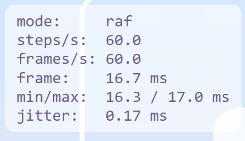
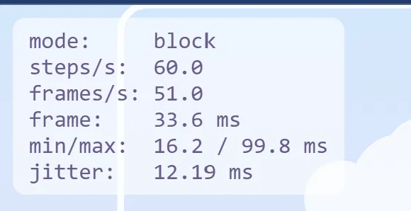
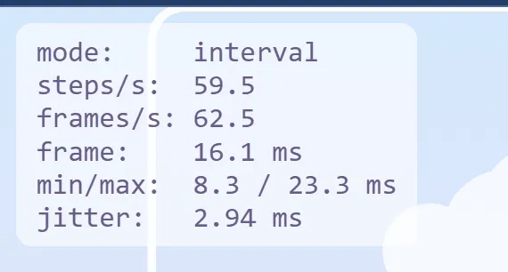
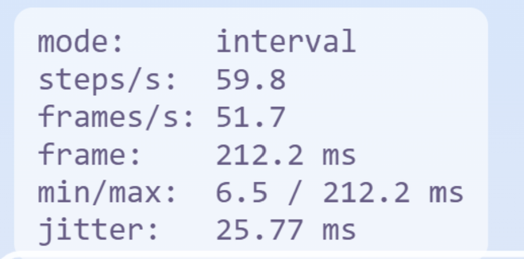
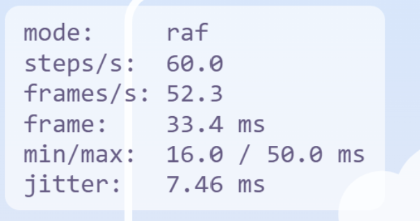
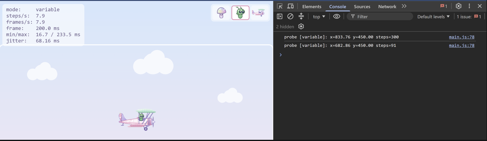
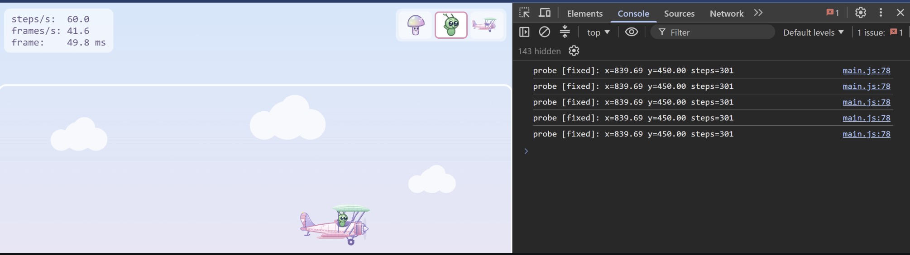

# Biplane Game

Лабораторна робота 1: «Event loop — це і є ігровий цикл».

Браузерна гра: пастельний біплан, яким літаєш по арені на canvas. Ігровий цикл побудований на `requestAnimationFrame` із фіксованим кроком симуляції. Фізика не залежить від частоти кадрів і від DOM.

## Запуск

```
npm install
npm run dev
```

Потрібен Node.js 24 (див. `.nvmrc`). Гра відкривається за адресою `http://localhost:5173/`.

Перевірка коду: `npx biome check .`

## Керування

| Клавіша | Дія |
|---|---|
| ← → ↑ ↓ або WASD | рух |
| H | показати або сховати HUD |
| P | вимірювання: 5 с польоту вправо, результат у консолі браузера |
| Пробіл | зарезервовано під стрільбу, поки без дії |

Героя в кабіні обирають на панелі у правому верхньому куті. Вибір зберігається в `localStorage`.

## Архітектура

```
src/
  loop.js      createLoop(): rAF + акумулятор, статистика (steps/s, frames/s, час кадру, jitter)
  input.js     createInput(): замикання над станом клавіш, isDown / justPressed / snapshot
  physics.js   integrate(ship, input, dt): чиста функція без DOM, загортання країв арени
  main.js      збірка всього, режими експериментів
  render/      малювання на canvas: DPR, інтерполяція, літак, герої
  ui/          панель вибору героя
```

- **Цикл.** Симуляція виконується з кроком рівно 1/60 с. Рендер отримує коефіцієнт `alpha` і малює стан між попереднім і поточним кроком, тому рух плавний на будь-якій частоті монітора. Кадр обмежений 0.25 с, щоб після зависання цикл не «наздоганяв» нескінченно (спіраль смерті).
- **Фізика.** `integrate` не змінює вхідний об'єкт, повертає новий стан і не залежить від DOM, тож її можна запускати в Node.
- **Введення.** Набір натиснутих клавіш прихований у замиканні. `justPressed` зберігається до виклику `endStep()` після кроку симуляції, тому натискання не губиться, коли в кадрі немає кроків, і не спрацьовує двічі, коли їх два.
- **Вид збоку.** Замість повороту й тяги вздовж курсу використано рух у чотири сторони з інерцією, тертям, обмеженням швидкості та нахилом носа від вертикальної швидкості. Механіка `integrate` лишається тією самою за суттю: прискорення, тертя, обмеження швидкості, загортання країв.
- **Canvas.** Розмір буфера множиться на `devicePixelRatio`, малювання ведеться в CSS-пікселях, арена масштабується під вікно й центрується.
- **Герої.** Кожен герой — окремий файл у `src/render/pilots/`, що малює себе в точці сидіння. Додати нового означає створити файл і додати рядок у реєстр `PILOTS`.

## Експерименти «зламай і поміряй»

Режими вмикаються параметром адреси: `/?exp=block`, `/?exp=interval`, `/?exp=variable`. У цих режимах HUD додатково показує мін/макс час кадру та jitter (стандартне відхилення тривалості кадру за секунду).

Середовище: Chrome, дисплей 60 Гц, Node.js 24, Vite 8.

Відтворення: відкрити потрібну адресу, зачекати кілька секунд і зняти показники з HUD. Для експерименту 3 клацнути по сторінці, натиснути **P** і прочитати результат у консолі (F12). CPU throttling вмикається в DevTools → Performance → шестерня → CPU.

### Базова лінія (rAF, фіксований крок)

Для розширеного HUD використано адресу `/?exp=raf`: невідомий параметр вмикає лише додаткові метрики, а цикл лишається звичайним.

| steps/s | frames/s | кадр | min / max | jitter |
|---|---|---|---|---|
| 60.0 | 60.0 | 16.7 мс | 16.3 / 17.0 мс | 0.17 мс |

Симуляція виконує приблизно 60 кроків на секунду, кадри йдуть із частотою монітора. Невеликі відхилення steps/s від 60 (наприклад, 59.0) трапляються, бо вікно вимірювання не дорівнює точно секунді.



### Експеримент 1. Блокуючий цикл у кадрі (`/?exp=block`)

У `render` кожен 60-й кадр виконується синхронне очікування 100 мс: `while (performance.now() < end) {}`.

| steps/s | frames/s | min / max | jitter |
|---|---|---|---|
| 60.0 | 51.0 | 16.2 / 99.8 мс | 12.19 мс |

Гравець бачить, що раз на секунду літак на мить завмирає й стрибає вперед. Порівняно з базовою лінією jitter зріс до 12.19 мс, а максимальний кадр дорівнює 99.8 мс. Кількість кроків симуляції не змінилася.

**Пояснення.** Колбек rAF — один шматок роботи на стеку викликів. JavaScript виконує його до кінця (run-to-completion), і нічого не може його перервати. Поки триває цикл, event loop не бере наступних задач: не малюється кадр, не обробляються клавіші та таймери. Після завершення колбека акумулятор бачить, що минуло близько 100 мс, і виконує шість кроків симуляції підряд. Тому steps/s лишається 60, а frames/s падає: кілька кадрів пропущено.

Обійти це з того самого потоку неможливо. У JavaScript немає витіснення (preemption), а `await` чи `setTimeout` лише переносять роботу на інший момент і не прискорюють її. Є два способи: розбити важку роботу на дрібні частини між кадрами або винести її у Web Worker, де працює окремий потік.



### Експеримент 2. `setInterval` замість rAF (`/?exp=interval`)

`requestAnimationFrame` замінено на `setInterval(frame, 16)`.

Вкладка на екрані:

| Прогін | steps/s | frames/s | min / max | jitter |
|---|---|---|---|---|
| 1 | 59.7 | 62.7 | 8.0 / 18.2 мс | 1.84 мс |
| 2 | 59.5 | 62.5 | 8.3 / 23.3 мс | 2.94 мс |

Для порівняння rAF у цих самих умовах див. базову лінію вище: там jitter помітно менший.

Знімки після повернення з фонової вкладки (10+ с у фоні, знімок зроблено одразу після повернення):

| Режим | steps/s | frames/s | min / max | jitter |
|---|---|---|---|---|
| `setInterval` | 59.8 | 51.7 | 6.5 / 212.2 мс | 25.77 мс |
| rAF | 60.0 | 52.3 | 16.0 / 50.0 мс | 7.46 мс |

HUD оновлюється, щойно накопичиться 1 секунда, тому довгий кадр показується в ньому близько секунди, а потім статистика скидається. Знімок міг потрапити вже на наступне вікно, тож максимуми 212 і 50 мс не відображають точну тривалість паузи. Ці числа лише показують, що після повернення обидва режими дали серію нерівних кадрів, а steps/s лишилося близько 60. Саму паузу rAF у фоні ці вимірювання не підтверджують.

**Пояснення.**
- Інтервал 16 мс дає 1000/16 = 62.5 кадрів на секунду. Це збігається з виміряними 62.5-62.7 і не пов'язане з частотою монітора (60 Гц): частина кадрів не потрапляє в оновлення екрана, а частина малюється без потреби.
- Колбек `setInterval` — це задача в черзі задач. Таймер лише додає її туди, коли спливає час, а виконується вона тільки тоді, коли стек порожній. Якщо потік зайнятий або браузер відкладає таймер, задача чекає. Звідси max 23 мс на екрані. Мінімум 6.5-8 мс означає, що після запізнення дві задачі виконалися майже підряд.
- rAF не є ні задачею, ні мікрозадачею, а кроком оновлення екрана: його викликає браузер прямо перед малюванням. Тому він синхронізований із монітором. За документацією браузер призупиняє rAF у фоновій вкладці, а таймери сильно сповільнює; у цій роботі це окремо не вимірювалося.
- Якщо кадр триває довше за 0.25 с, акумулятор відкидає зайвий час (clamp), і симуляція не «перемотується». Саме для цього clamp потрібен.
- steps/s лишається близько 60 в обох режимах, бо акумулятор рахує справжній час, а не кількість викликів. Втрачається плавність картинки, а не точність симуляції.





### Експеримент 3. Змінний крок замість фіксованого (`/?exp=variable`)

Акумулятор вимкнено: `simulate(dt)` викликається один раз на кадр із реальним `dt`. Для вимірювання по клавіші **P** літак на 5 секунд симуляційного часу летить вправо, після чого в консоль виводиться позиція. У DevTools використано CPU throttling 6× slowdown. Координата `x` подана після загортання країв арени (ширина 1600).

| Режим | CPU | x | steps |
|---|---|---|---|
| змінний крок | без throttling | 833.69 (перший прогін) і 833.76 (другий, на знімку) | 300 |
| змінний крок | 6× slowdown | **682.86** | **91** |
| фіксований крок | без throttling | 839.69 | 301 |
| фіксований крок | різні значення slowdown (5 прогонів) | 839.69 | 301 |

Зі змінним кроком траєкторія залежить від навантаження: різниця близько 150 px за 5 секунд. Навіть без throttling два прогони трохи розходяться (833.69 і 833.76). З фіксованим кроком результат однаковий у кожному прогоні при будь-якому навантаженні.

**Пояснення.** Інтегрування прискорення й тертя з різним `dt` дає різні результати: чим більший крок, тим грубіший наближений розрахунок, а обмеження швидкості спрацьовує в інші моменти. Під throttling за 5 секунд симуляційного часу виконано лише 91 крок замість 300, тобто середній крок становив близько 55 мс. У момент знімка HUD показував ще важче навантаження (7.9 frames/s), бо затримка під throttling коливається. Крім того, `dt` обмежений 0.25 с, тому симуляційний час не дорівнює реальному.

При фіксованому кроці кількість кроків залежить лише від проминулого часу, а не від кількості кадрів, і кожен крок однаковий. Тому симуляція **детермінована**: ті самі вхідні дані дають той самий результат на будь-якому комп'ютері. Для мультиплеєра (лаба 5) це критично: сервер і клієнти мають рахувати однаково.

Число 301 замість 300 у фіксованому режимі пояснюється накопиченням похибки: сума 300 доданків 1/60 виходить трохи меншою за 5, тож для умови завершення вимірювання потрібен ще один крок. Воно стабільне між прогонами й на висновок не впливає.




## Висновки

- Колбек rAF виконується до кінця на одному потоці, тому будь-яка синхронна робота в кадрі затримує малювання, події та таймери (експеримент 1).
- rAF синхронізований із монітором і дає значно менший jitter, ніж `setInterval`, який лише ставить задачу в чергу за таймером (експеримент 2).
- Фіксований крок з акумулятором робить симуляцію детермінованою й незалежною від навантаження та частоти кадрів, тому саме він потрібен для мультиплеєра (експеримент 3).