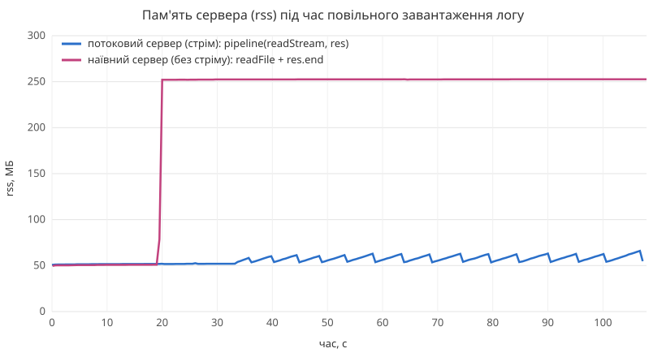

# Biplane Game

Лабораторна робота 4: «Node.js: EventEmitter, streams, WebSocket-сервер».

Браузерна гра: пастельний біплан, яким літаєш по арені на canvas.
- [lab-01](https://github.com/Sol777xxx/biplane-game/tree/lab-01): ігровий цикл, фіксований крок, експерименти з event loop.
- [lab-02](https://github.com/Sol777xxx/biplane-game/tree/lab-02): сутності, `World` на `Map`, колізії, кулі, композиція поведінок.
- [lab-03](https://github.com/Sol777xxx/biplane-game/tree/lab-03): пайплайн ассетів, екран завантаження, звук, шина подій, лобі.

## Запуск

```
npm install
cp server/.env.example server/.env     # PowerShell: Copy-Item server/.env.example server/.env
npm run dev:server                     # термінал 1: сервер на :3000
npm run dev                            # термінал 2: клієнт (Vite) на :5173
```

Гра в режимі розробки: `http://localhost:5173/`. Vite проксіює `/api` і `/ws` на сервер (`vite.config.js`), тож клієнт ходить на свій origin.

Режим «як у проді»: `npm run build`, потім `npm start`. Сервер сам роздає зібраний `client/dist` на `http://127.0.0.1:3000/`.

Потрібен Node.js 24 (див. `.nvmrc`). Перевірка коду: `npx biome check .` · тести: `npm test` (обидва пакети).

> На Windows зупиняйте сервер через `Ctrl+C` і запускайте його через `node src/index.js` (не через `npm run`): npm перехоплює сигнал, і graceful shutdown у процесі не відбувається. SIGTERM Windows не доставляє взагалі.


## Керування

| Клавіша | Дія |
|---|---|
| ← → ↑ ↓ або WASD | рух |
| Пробіл | стрільба |
| H | показати або сховати діагностику (steps/s, frames/s); за замовчуванням схована |
| Enter | відкрити чат; Enter надсилає, Esc повертає керування грі |
| P | вимірювання (лаба 1): 5 с польоту вправо, результат у консолі |

Героя в кабіні обирають на панелі справа вгорі. Адреса з `?debug` відкриває `window.game` і `window.assets` у консолі та показує хітбокси.

Параметри адреси лаби 3: `?latency=300` (затримка на кожен файл), `?seq` (завантажувати по черзі), `?chaos=…` (навмисні збої, див. галерею), `?delay=5000` (затримка відповіді лобі), `?bake` (зберегти спрайтшит).

## Правила гри

- Хмарки дрейфують і відбиваються від країв; наліт на хмарку знімає 35 HP і знищує її.
- Кулі шкодять хмаркам (знищується за 2–3 влучання, очки = радіус) і кораблям. Біплан, вилетівши за край арени, з'являється з протилежного боку, а куля за межею зникає.
- Над збитою хмаркою спливає «+N» (скільки очок додано).
- Знищений біплан вибухає й відроджується через 2 с у безпечній точці зі щитом на 2 с.
- Pickup'и (зірки): **S** щит, **R** швидкострільність, **H** самонавідні кулі. Частина хмарок наводиться на біплан.
- Параметри арени залежать від кімнати, обраної в лобі (див. розділ «Лобі»).


## Архітектура

```
client/                  усе, що було в лабах 1–3 (Vite, canvas, ассети)
  src/net/
    connection.js        обгортка над WebSocket: черга, reconnect з backoff
    roomSession.js       join кімнати поверх connection, повторний join після reconnect
  src/ui/chatPanel.js    чат (textContent, без innerHTML)
server/
  src/
    index.js             точка входу: конфіг → сервер → graceful shutdown
    config.js            PORT / HOST / LOG_DIR / MAX_ROOMS з оточення, з перевіркою
    app.js               node:http, маршрути, життєвий цикл (listen / close)
    static.js            роздача client/dist: MIME, захист від ..
    api.js, body.js, respond.js, replayRoutes.js   REST, читання тіла, відповіді
    rooms.js             Room і RoomManager (EventEmitter)
    protocol.js          формат повідомлень, валідація, коди закриття
    ws.js                WebSocket: join, heartbeat, ліміти, повільні клієнти
    limits.js            token bucket
    log/matchlog.js      події кімнати → Transform (NDJSON) → pipeline → файл
    log/replay.js        читання NDJSON потоком
  tools/                 chat-client, flood, bigframe, lag-demo, експеримент з rss
  test/                  node --test
docs/rss.svg             графік пам'яті          
```

## Конфігурація

Читається з оточення (`node --env-file=.env`), перевіряється при старті; усі помилки виводяться разом, процес завершується з кодом 1.

| Змінна | За замовчуванням | Значення |
|---|---|---|
| `PORT` | `3000` | ціле 0–65535 |
| `HOST` | `127.0.0.1` | адреса прослуховування |
| `LOG_DIR` | `./logs` | куди писати журнали матчів |
| `MAX_ROOMS` | `50` | ліміт кімнат на сервері (ціле ≥ 1) |
| `ENABLE_SLOW` | вимкнено | `1` вмикає `/api/slow` (демонстрація блокування, лише для експериментів) |
| `CLIENT_DIR` | `client/dist` | що роздавати як статику |

## HTTP API

| Запит | Відповідь |
|---|---|
| `GET /health` | `{ status, uptime, rss, heapUsed }` |
| `GET /api/rooms` | список кімнат |
| `POST /api/rooms` | створює кімнату: `{ name, max?, preset? }`, `201` + `Location`; `503`, якщо досягнуто `MAX_ROOMS` |
| `GET /api/replays` | список журналів матчів |
| `GET /api/replays/:id` | файл журналу потоком (`application/x-ndjson`) |
| `GET /api/slow?ms=300&mode=block\|sleep` | лише з `ENABLE_SLOW=1`, інакше `404` |

Помилки це JSON з тим самим статусом: `400` (погане тіло/параметри), `404`, `405` (з `Allow`), `413` (тіло > 1 КБ), `415` (не JSON).
Статика: шлях із `..` дає `403`, зламане `%`-кодування `400`; перевірка йде за сирим `req.url`, бо `URL` сам «нормалізує» `/../`.

## Протокол WebSocket (v1)

Кожне повідомлення це JSON з `v: 1` і `type`. Набір полів **строгий**: зайве чи відсутнє поле це порушення протоколу.

| Напрямок | `type` | Поля |
|---|---|---|
| клієнт → сервер | `join` | `room` (`[\w-]{1,32}`), `name` (1–16 символів) |
| клієнт → сервер | `chat` | `text` (1–200 символів) |
| клієнт → сервер | `leave` | немає |
| сервер → клієнт | `joined` | `you`, `room`, `players` |
| сервер → клієнт | `roster` | `players` |
| сервер → клієнт | `chat` | `name`, `text` |
| сервер → клієнт | `error` | `code`, `message` (після нього сокет закривається) |

Перше повідомлення мусить бути `join` і прийти за 5 с. Порушення закриває сокет із кодом:

| Код | Причина | Клієнт перепідключається? |
|---|---|---|
| 1000 | нормальне закриття (`leave`) | ні |
| 1001 | сервер зупиняється | так |
| 1003 | бінарний кадр | ні |
| 1009 | кадр більший за `maxPayload` (2048 Б) | ні |
| 1011 | внутрішня помилка | так |
| 4000 | не JSON, чужа версія, зайве чи погане поле | ні |
| 4001 | невідомий `type` | ні |
| 4002 | `join` не прийшов за 5 с | ні |
| 4003 | повідомлення до `join` | ні |
| 4004 | повторний `join` | ні |
| 4005 | кімнати немає | ні |
| 4006 | кімната заповнена | ні |
| 4007 | ім'я зайняте | так, після першого успішного join (сервер ще міг не прибрати мертвий сокет) |
| 4008 | перевищено ліміт повідомлень | ні |
| 4009 | клієнт надто повільний | ні |

### Життя з'єднання

- **Heartbeat**: сервер шле `ping` раз на 15 с; два пропущені `pong` поспіль і сокет рветься (`terminate`). Без цього «мертві» з'єднання (клієнт зник без `close`) жили б вічно і тримали місце в кімнаті.
- **Клієнт** (`connection.js`): повідомлення, надіслані до відкриття, стоять у черзі; після `open` спершу йде `join`, потім решта. Reconnect з exponential backoff і jitter. Закриття, ініційоване користувачем, повторів не викликає.
- **Graceful shutdown**: `SIGINT` / `SIGTERM` → `server.close()`, сокетам `1001`, після 3 с решта з'єднань рубається. Порядок закриття: кімнати → сокети → журнали матчів (щоб події виходу гравців потрапили у файл). Код виходу 0.

## Кімнати: `EventEmitter`

`Room extends EventEmitter` не знає про сокети; кожен сокет підписується на події сам і відписується при закритті.

| Подія | Коли |
|---|---|
| `join`, `leave`, `chat` | гравець зайшов, вийшов, написав |
| `matchstart` | зайшов перший гравець у порожню кімнату |
| `empty` | вийшов останній (`RoomManager` видаляє непостійну кімнату) |
| `event` | кожна з подій вище в єдиному форматі `{ t, type, … }`, джерело для журналу |

`RoomManager extends EventEmitter` кидає `created`. Кімната, куди ніхто не зайшов, видаляється через 60 с, інакше `POST /api/rooms` створював би їх назавжди.
Кімнати не емітують `"error"`: помилки валідації це виключення з `RoomError`, а не подія без слухача.

## Журнал матчу і повтор: потоки

```
room "event" → NdjsonTransform (objectMode) → createWriteStream(<LOG_DIR>/<room>-<час>.ndjson)
```

`pipeline` з'єднує ланки й передає помилку з будь-якої на всі. Матч це період, коли в кімнаті є хоча б один гравець: `match_start` … `match_end`, по рядку JSON на подію.
`GET /api/replays/:id` віддає файл через `pipeline(createReadStream, res)`, а `replay.js` читає його як асинхронний генератор (`readEvents`), складаючи шматки в рядки. Id перевіряється регулярним виразом `^[\w-]{1,128}$` за сирим шляхом, тож вийти з `LOG_DIR` неможливо.

## Захист від зловживань

| Загроза | Захист |
|---|---|
| сплеск повідомлень | token bucket на з'єднання: сплеск до 10, у середньому 5/с; далі `4008` |
| величезний кадр | `maxPayload` 2048 Б: `ws` відкидає кадр до того, як зібрати його в пам'ять (`1009`) |
| сміття замість JSON | строга валідація, ключі типу `__proto__` / `toString` відхиляються через `Object.hasOwn` |
| забагато кімнат | `MAX_ROOMS` (`503` на `POST`) |
| забагато гравців | `max` кімнати (1–8), `4006` |
| «німий» клієнт | таймер `join` 5 с, heartbeat |
| повільний клієнт | політика за `ws.bufferedAmount`, див. нижче |
| важка відповідь у пам'ять | журнали віддаються потоком, тіло запиту обмежене 1 КБ |

**Повільний клієнт.** Якщо клієнт не читає, байти копляться в буфері сокета, а при розсилці на N клієнтів це N копій. Є два пороги: вище 16 КБ сервер перестає слати цьому клієнтові `chat` (потік, втрата одного повідомлення не ламає стан); вище 256 КБ з'єднання закривається кодом `4009`. `roster` не відкидається, бо це стан, а не потік. Якщо клієнт не прочитає навіть `close`-кадр, через 1 с сокет рветься примусово.

## Експеримент: пам'ять під час повільного завантаження (backpressure)

Журнал на 200 МБ (`tools/make-big-log.mjs`) віддається клієнтові, який читає зі швидкістю 2 МБ/с (`tools/slow-download.mjs`), тобто завантаження триває близько 100 с. Раз на 0,5 с монітор читає `rss` з `/health`.
Порівнюються два сервери: наш (`pipeline(readStream, res)`) і навмисно наївний (`readFile` + `res.end`, `tools/naive-replay-server.mjs`).



| Сервер | rss до завантаження | Пік rss | Приріст |
|---|---|---|---|
| потік (`pipeline`) | 52 МБ | 66 МБ | +14 МБ |
| `readFile` + `res.end` | 51 МБ | 254 МБ | +203 МБ |

Крива потоку коливається «пилкою» в межах 52–66 МБ: V8 накопичує прочитані шматки по 64 КБ і періодично збирає їх. Пам'ять не залежить від розміру файлу. Крива `readFile` стрибає приблизно на розмір файлу (з 51 до 254 МБ) у момент початку завантаження й тримається, поки клієнт не забере файл.

Відтворити:

```
cd server
node tools/make-big-log.mjs 200 big-200mb
node src/index.js                                                  # вікно A
node tools/rss-monitor.mjs http://127.0.0.1:3000/health rss-stream.csv   # вікно B
node tools/slow-download.mjs http://127.0.0.1:3000/api/replays/big-200mb 2048   # вікно C
# те саме для naive-replay-server.mjs на :3001 (rss-naive.csv), потім:
node tools/plot-rss.mjs ../docs/rss.svg "стрім: pipeline(readStream, res)=rss-stream.csv" "без стріму: readFile + res.end=rss-naive.csv"
```

## Нотатка: event loop, backpressure і необроблені помилки

### Фази event loop і блокування

Цикл подій Node.js проходить фази: **timers** (колбеки `setTimeout`/`setInterval`) → **pending callbacks** → **poll** (нові I/O-події: сокети, файли; тут сервер приймає запити й повідомлення WebSocket) → **check** (`setImmediate`) → **close callbacks**. Між колбеками виконуються `process.nextTick` і мікрозадачі (проміси). Весь JavaScript виконується в одному потоці: поки один колбек не завершився, жоден інший не стартує.

Тому синхронна робота блокує всіх. `GET /api/slow?mode=block` крутить цикл 300 мс. Чат-зонд (`tools/lag-demo.mjs`) шле повідомлення в чат кожні 250 мс і міряє, за який час сервер повертає його назад:

```
режим: block; /api/slow?ms=300 у 2, 5, 8 с
p7: 271 мс  ← цикл подій був зайнятий
p19: 131 мс  ← цикл подій був зайнятий
p30: 288 мс  ← цикл подій був зайнятий

прозонд: 46, медіана 1.2 мс, максимум 287.9 мс, ≥ 50 мс: 3
```

```
режим: sleep; /api/slow?ms=300 у 2, 5, 8 с

прозонд: 46, медіана 1.2 мс, максимум 2.9 мс, ≥ 50 мс: 0
```

Поки йде блокувальний обробник, повідомлення стоять у черзі I/O: медіана затримки 1,2 мс, але під час блокування вона сягає 288 мс. Три стрибки (271, 131 і 288 мс) відповідають трьом запитам до `/api/slow`; 131 мс менше, бо повідомлення зонда потрапило в кінець блокування, коли лишалась частина з 300 мс. Режим `sleep` теж займає 300 мс, але це таймер: потік вільний, максимум затримки 2,9 мс, жодного стрибка.
Висновок: довга синхронна робота (великий `JSON.parse`, цикл, синхронне читання файлу) в обробнику затримує **всіх** підключених клієнтів, тож таку роботу виносять у потоки (worker threads) або розбивають на частини. Тому ж ендпоїнт `/api/slow` увімкнено лише через `ENABLE_SLOW=1`.

### Backpressure

`res.write(chunk)` повертає `false`, коли внутрішній буфер переповнений, і це сигнал «припини писати, чекай `drain`». Якщо його ігнорувати, дані копляться в пам'яті процесу; це і є східець на графіку «readFile». `pipeline` робить це за нас: призупиняє читання файлу, поки клієнт не наздожене, тож пам'ять визначається розміром шматка (64 КБ), а не файлу.
Backpressure у проєкті зустрічається тричі: (1) відповідь на `GET /api/replays/:id`, (2) запис журналу матчу (`pipeline` між `Transform` і файлом), (3) `ws.bufferedAmount` у WebSocket: там вбудованої паузи немає, тому політику (відкинути `chat`, закрити з'єднання) довелося написати самим.

### Чому необроблена помилка валить процес

Подія з іменем `"error"` у `EventEmitter` особлива: якщо слухача немає, `emit("error", err)` **кидає** `err`. Виклик відбувається всередині внутрішнього колбека (обробник сокета), де немає коду, який міг би зробити `try/catch`, тож виняток доходить до верху як `uncaughtException`, і процес завершується з кодом 1. Один клієнт, що надіслав кадр понад `maxPayload`, поклав би сервер усім.
Так само з промісами: відхилений проміс без `.catch` (наприклад, `async`-обробник HTTP без `try/catch`) з Node 15 є `unhandledRejection`, який за замовчуванням теж завершує процес.

Відтворення: у `server/src/ws.js` тимчасово закоментуйте рядок `ws.on("error", …)`, запустіть сервер і надішліть кадр більший за 2048 Б (`node tools/bigframe.mjs` у чат-клієнті):

```
node:events:486
      throw er; // Unhandled 'error' event
      ^
RangeError: Max payload size exceeded
    at Receiver.haveLength (…\node_modules\ws\lib\receiver.js:442:28)
    at Receiver.getPayloadLength16 (…\node_modules\ws\lib\receiver.js:393:10)
    at Receiver.startLoop (…\node_modules\ws\lib\receiver.js:181:16)
    at Receiver._write (…\node_modules\ws\lib\receiver.js:117:10)
    ...
    at Socket.socketOnData (…\node_modules\ws\lib\websocket.js:1407:35)
Emitted 'error' event on WebSocket instance at:
    at Receiver.receiverOnError (…\node_modules\ws\lib\websocket.js:1251:15)
    ... {
  code: 'WS_ERR_UNSUPPORTED_MESSAGE_LENGTH',
  Symbol(status-code): 1009
}
Node.js v24.13.0
```

Після повернення обробника `"error"` той самий кадр лише закриває цей один сокет: клієнт отримує `закрито: 1009`, а сервер продовжує працювати. 
Виправлення: `ws.on("error", (error) => log.warn(…))` першим рядком в обробнику `connection` (кадр тоді просто закриває цей один сокет з кодом `1009`), `try/catch` навколо обробника повідомлень (виняток закриває сокет з `1011`) і навколо асинхронного HTTP-обробника (відповідь `500`). У `app.test.mjs` і `ws.test.mjs` є тести, що сервер переживає такі випадки.

## Галерея збоїв (сервер)

| Збій | Як відтворити | Що відбувається |
|---|---|---|
| сервер зупинено, клієнт у кімнаті | `Ctrl+C` на сервері | клієнт отримує `1001`, перепідключається з backoff, після повернення сервера знову робить `join` |
| сервер недоступний при старті | не запускати сервер | лобі показує помилку мережі, опитування триває |
| спам | `node tools/flood.mjs 50` | `закрито: 4008 rate limit` | `chat-client.mjs` + ручні повідомлення | `4000` / `4001`, з поясненням у повідомленні `error` |
| кімнату заповнено, ім'я зайняте | другий клієнт в ту саму кімнату | `4006` / `4007`, клієнт показує зрозуміле повідомлення |
| `..` у шляху статики | `curl.exe --path-as-is http://127.0.0.1:3000/../package.json` | `403` |
| забагато кімнат | `MAX_ROOMS=3` і `POST /api/rooms` | `503` |
